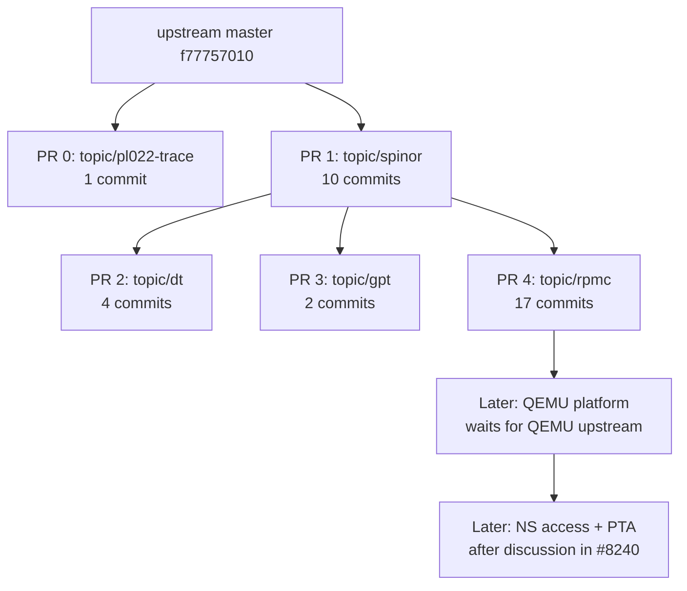

# 2. Scope of work

The work is split into independently reviewable pull requests against
upstream optee_os `master`. Each has a branch in
[bhaskarv79/optee_os](https://github.com/bhaskarv79/optee_os); a manifest per
branch in [bhaskarv79/manifest](https://github.com/bhaskarv79/manifest)
(branch `spinor`, `spinor-topic-*.xml`) builds and runs it with the standard
`repo sync; make run` flow.

## 2.1 Work packages

`topic/integration` stacks all of them (44 commits, plus the DT/GPT hook) and
is what the QEMU demo runs.

### PR 0: PL022 tracing (`topic/pl022-trace`)

| Deliverable | Detail |
| --- | --- |
| `core/drivers/pl022_spi.c` | Per-transfer trace messages from debug to flow level, so a SPI-NOR boot log stays readable |

Independent of the rest; can be merged first.

### PR 1: SPI-NOR driver and SPI-NOR FS (`topic/spinor`)

| Commit | Deliverable |
| --- | --- |
| drivers: spi: add SPI memory framework | `core/include/drivers/spi_mem.h`, `core/drivers/spi/spi_mem.c`, adapter for `struct spi_chip` controllers (`spi_mem_legacy.c`), `CFG_DRIVERS_SPI_MEM` |
| core: pta: tests: add spi-mem self test | spi-mem tests in `xtest 1001` |
| drivers: spi_nor: add SPI-NOR flash core with SFDP | `core/drivers/spi_nor/core.c`, `sfdp.c`, `ids.c`, `core/include/drivers/spi_nor.h`, `CFG_DRIVERS_SPI_NOR` |
| drivers: spi_nor: add flash simulator and self tests | `spi_nor_sim.c`, `spi_nor_selftest.c`, `CFG_SPI_NOR_SIM` |
| core: tee_ree_fs: split storage transport into a backend | `core/include/tee/tee_fs_backend.h`, `struct fs_instance` in `tee_ree_fs.c`; REE FS behaviour unchanged |
| core: tee_ree_fs: truncate the stored file after the commit | Truncation made power-loss safe |
| core: spinor_fs: add SPI-NOR FS secure storage | `core/tee/spinor_fs_store.c`, `spinor_fs_ops`, `TEE_STORAGE_PRIVATE_SPI_NOR`, `CFG_SPI_NOR_FS` |
| ci: test SPI-NOR FS on QEMUv8 with the simulated flash | CI job |
| drivers: spi_nor: add named partitions | `partition.c`: label, offset, size; alignment and overlap checks |
| core: spinor_fs: use the optee-fs flash partition | The store region from the `optee-fs` partition |

Without RPMC there is no rollback anchor, so PR 1 mounts the store only with
`CFG_INSECURE=y`; the PR description has to say so.

### PR 2: Device tree (`topic/dt`)

| Commit | Deliverable |
| --- | --- |
| core: kernel: dt_driver: add DT_DRIVER_SPI type | Driver type for SPI controllers |
| drivers: spi: probe SPI memory devices from the device tree | Controller providers |
| drivers: spi_nor: probe flashes from the device tree | `jedec,spi-nor` nodes |
| drivers: spi_nor: read partitions from the device tree | `partitions` subnode, `label`, `reg`, `optee,ns-access` |

### PR 3: GUID partition table (`topic/gpt`)

| Commit | Deliverable |
| --- | --- |
| drivers: spi_nor: read partitions from a GUID partition table | `core/drivers/spi_nor/gpt.c`, `spi_nor_gpt_add_partitions()`, `CFG_SPI_NOR_GPT` |
| drivers: spi_nor: test the GUID partition table parser | Self tests on in-memory tables |

The commit "read the GPT of a DT flash without partitions" connects PR 2 and
PR 3 and goes with whichever of the two lands second. Until then PR 3 has no
caller outside its tests.

### PR 4: Rollback protection with RPMC (`topic/rpmc`)

| Area | Deliverables |
| --- | --- |
| RPMC driver | SFDP RPMC parameter table, key commands, read and increment counters, simulator support and tests (`rpmc.c`, `rpmc_counter.c`, `spi_nor_rpmc.h`, `CFG_SPI_NOR_RPMC`, `CFG_RPMC_WRITE_ROOT_KEY`) |
| Keys | `HUK_SUBKEY_RPMC` |
| Anchors | `nv_counter_*_spinor_fs()` hooks, RPMC counters as monotonic counters, anchor selection and policy (`CFG_SPI_NOR_FS_ANCHOR`, `optee,rollback-anchor`), `CFG_SPI_NOR_FS_ALLOW_RESET`, test NV counter |
| Hash tree | "start a new hash tree above the minimum counter" (fixes reset with a non-zero anchor) |
| REE FS | `CFG_REE_FS_INTEGRITY_RPMC` |
| Default storage | `CFG_SPI_NOR_FS_DEFAULT`, TEE bus stage 1 enumeration, `CFG_STMM_STORAGE_SPI_NOR` |
| Tests | Replay of an old flash image |

### Later: QEMU platform and normal-world access

| Package | Deliverables | Waits for |
| --- | --- | --- |
| QEMU platform | `plat-vexpress/spi_nor_qemu.c`, `CFG_QEMU_SPI_NOR`, flash layout, boot report, GPT on the flash | The QEMU patches (secure PL022, RPMC flash model) on qemu-devel |
| NS access | `spi_nor_ns.c`, `core/pta/spi_nor.c`, `pta_spi_nor.h`, `CFG_SPI_NOR_NS_ACCESS`, `CFG_SPI_NOR_PTA` | Agreement in #8240 on the interface |

### Outside optee_os

| Repository | Branch | Deliverable |
| --- | --- | --- |
| optee_test | `spinor` | `TEE_STORAGE_PRIVATE_SPI_NOR` in the 6000 tests; detection of the storage behind `TEE_STORAGE_PRIVATE` |
| build | `spinor` | `SPINOR=n\|sim\|flash`; flash image with protective MBR, primary and backup GPT, boot and kernel images (`qemu-spinor-image.sh`) |
| manifest | `spinor` | `spinor.xml`, `spinor-topic-*.xml` |
| QEMU | `spinor-v10.0`, `rpmc-m25p80` | Secure PL022 on `virt`, RPMC model for m25p80 flashes (to qemu-devel by mail) |
| optee_docs | `spinor-lld` | This document set; later an `.rst` chapter |

## 2.2 Out of scope

| Item | Reason |
| --- | --- |
| Fast, dual and quad read; quad enable | Not needed for correctness; performance work after merge |
| SFDP 4-byte addressing dword (DWORD16) | Tracked as an open item (REQ-RES-03) |
| Other SPI controllers than PL022 | Platform work; any controller with a `spi_chip` or spi-mem driver plugs in |
| Linux MTD driver | Replaced by the PTA and a planned user-space library |
| RPMB emulation over SPI-NOR | Dropped (REQ-DRP-01) |
| Erase counters and wear statistics | Not stored; round-robin allocation only |
| Migration of objects from REE FS or RPMB FS | Objects stay under their own storage ID |
| Write protection of flash regions (status register, block protect) | Not used; the bus is secure-only |

## 2.3 Open items

From the review of the topic branches (grade B, no critical findings):

| # | Item | Where | Owner PR |
| --- | --- | --- | --- |
| 1 | A GPT error on a DT flash without partitions fails the probe and panics the boot; it should log and continue without partitions | `core.c`, DT/GPT hook | PR 2/3 |
| 2 | One GPT entry that is not erase aligned rejects the whole table; it should skip that entry | `gpt.c` | PR 3 |
| 3 | PR 3 has no caller until the DT/GPT hook lands | series | PR 3 |
| 4 | QEMU addresses: `0x090c0000` for the SPI controller matches the QEMU v10.0 branch, not the qemu-devel series (`0x090d0000`) | `spi_nor_qemu.c` | QEMU platform |
| 5 | 4-byte address mode is entered with B7h without reading SFDP DWORD16 | `core.c` | PR 1 |
| 6 | The SPI-NOR FS commit is one 1,464-line commit; split before posting | series | PR 1 |
| 7 | Anchor lags one commit after a power cut between the dirf.db commit and the anchor raise | `tee_ree_fs.c` | PR 4 |
| 8 | Allocation cursor restarts at sector 0 at every mount | `spinor_fs_store.c` | PR 1 |
| 9 | With anchor 0, a corrupt dirf.db is removed and the store restarts empty | `tee_ree_fs.c` (existing REE FS behaviour) | PR 1 |
| 10 | optee_docs chapter and DT binding documentation | optee_docs | all |

## 2.4 Status

| Package | Builds per commit | Tests | Posted upstream |
| --- | --- | --- | --- |
| PR 0 | Yes | n/a | No |
| PR 1 | Yes | `xtest 1001 _60`: 2,396 subtests, 0 failed | No |
| PR 2 | Yes | same, 0 failed | No |
| PR 3 | Yes | same, 0 failed; GPT fuzzing clean | No |
| PR 4 | Yes | same, 0 failed; replay test | No |
| Integration | Yes | QEMU flash boots with persistence and GPT, `xtest 1001 _60` 0 failed | No |

Nothing is posted until the branches are reviewed.
