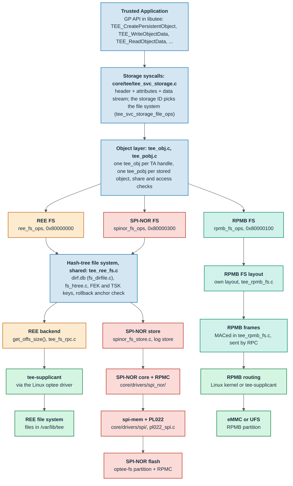
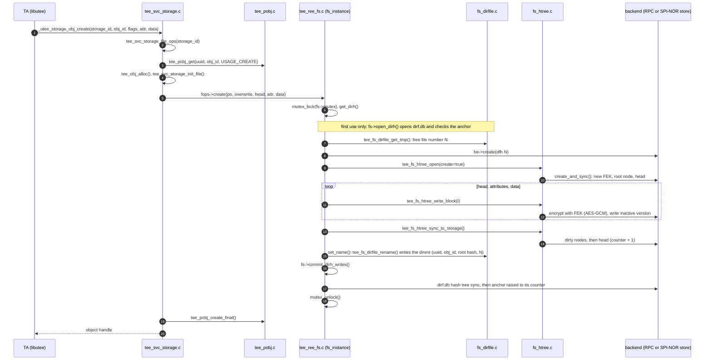
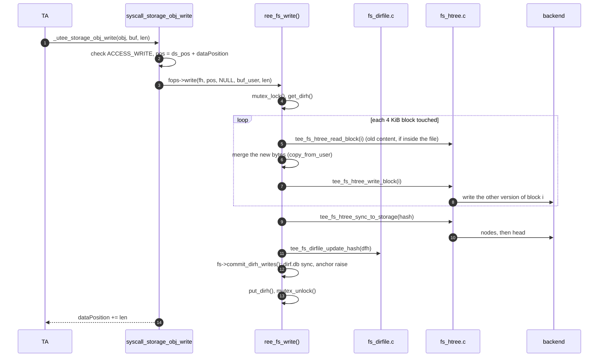
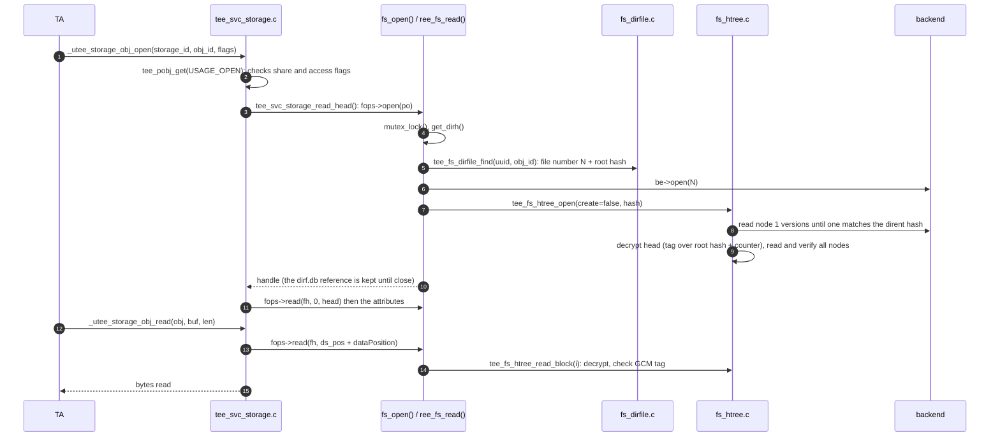

# Architecture

Layers of the secure storage stack, where each lives in the source, the storage IDs and how a TA call reaches the media.

Part of the [SPI-NOR secure storage low-level design](../README.md).

## At a glance

Blue boxes are the layers every storage ID shares, orange is the REE FS path, red is SPI-NOR FS (added by this series), teal is the RPMB FS path, and green runs in the normal world or is the storage device. Not drawn: the rollback anchor of SPI-NOR FS is an RPMC counter of the same flash, and REE FS can keep its anchor (dirfile.db.hash) in RPMB FS with CFG_REE_FS_INTEGRITY_RPMB.

The three top layers are common to all storage IDs. REE FS and SPI-NOR FS share the hash-tree file system and differ only below the backend interface; RPMB FS has its own layout. Only SPI-NOR FS keeps every byte in the secure world.

## Source map

Each layer has one interface struct or entry point that the layer above calls. Paths are relative to `optee_os/`.

| Layer | Files | Key structs | Entry points |
| --- | --- | --- | --- |
| 1. GP storage API (TA side) | `lib/libutee/tee_api_objects.c` | `TEE_ObjectHandle` (a user address) | `TEE_CreatePersistentObject`, `TEE_OpenPersistentObject`, `TEE_ReadObjectData`, `TEE_WriteObjectData`, `TEE_TruncateObjectData`, `TEE_SeekObjectData`, `TEE_RenamePersistentObject`, `TEE_CloseAndDeletePersistentObject1`, enumerator calls |
| 2. Syscalls | `lib/libutee/arch/*/utee_syscalls_asm.S`, `core/tee/tee_svc_storage.c` | `struct tee_svc_storage_head`, `struct tee_storage_enum` | `syscall_storage_obj_open/create/del/rename/read/write/trunc/seek`, `syscall_storage_*_enum` |
| 3. Object layer | `core/tee/tee_obj.c`, `core/tee/tee_pobj.c` | `struct tee_obj` (one per TA handle), `struct tee_pobj` (one per stored object, shared) | `tee_pobj_get()`, `tee_pobj_release()`, `tee_obj_add()` |
| 4. File system per storage ID | `core/include/tee/tee_fs.h`, `core/tee/tee_ree_fs.c`, `core/tee/tee_rpmb_fs.c` | `struct tee_file_operations`, `struct fs_instance`, `struct tee_fs_fd` | `tee_svc_storage_file_ops()`, `ree_fs_ops`, `spinor_fs_ops`, `rpmb_fs_ops` |
| 5. Directory file | `core/tee/fs_dirfile.c` | `struct tee_fs_dirfile_dirh`, `struct dirfile_entry`, `struct tee_fs_dirfile_fileh` | `tee_fs_dirfile_open/find/get_tmp/rename/remove/update_hash/commit_writes` |
| 6. Hash tree file format | `core/tee/fs_htree.c`, `core/include/tee/fs_htree.h` | `struct tee_fs_htree`, `struct tee_fs_htree_image` (head), `struct tee_fs_htree_node_image` | `tee_fs_htree_open/read_block/write_block/truncate/sync_to_storage` |
| 6a. Keys | `core/tee/tee_fs_key_manager.c`, `core/kernel/huk_subkey.c` | SSK, TSK, FEK | `tee_fs_fek_crypt()`, `huk_subkey_derive()` |
| 7. Storage backend | `core/include/tee/tee_fs_backend.h` | `struct tee_fs_backend_ops`, `struct tee_fs_htree_storage` | `.open/.create/.close/.truncate/.remove`, `rpc_read_init/final`, `rpc_write_init/final` |
| 7a. REE FS transport | `core/tee/tee_fs_rpc.c`, `optee_client/tee-supplicant/src/tee_supp_fs.c` | `struct tee_fs_rpc_operation` | `tee_fs_rpc_open_dfh()`, `OPTEE_RPC_CMD_FS` (open, create, read, write, truncate, remove) |
| 7b. SPI-NOR FS store | `core/tee/spinor_fs_store.c` | `struct sfs`, `struct sfs_rec_hdr`, `struct sfs_item` | `spinor_fs_backend`, `sfs_write_item()`, `sfs_read_item()`, `compact()` |
| 8. Flash stack (SPI-NOR only) | `core/drivers/spi_nor/*.c`, `core/drivers/spi/spi_mem*.c`, `core/drivers/pl022_spi.c` | `struct spi_nor`, `struct spi_mem_op`, `struct spi_chip` | `spi_nor_read/write/erase()`, `spi_mem_exec_op()` |
| 9. Rollback anchor | `core/kernel/nv_counter.c`, `core/drivers/spi_nor/rpmc*.c`, `core/tee/tee_rpmb_fs.c` | platform NV counter, RPMC counter, RPMB `dirfile.db.hash` | `nv_counter_get/incr_*()`, `spi_nor_rpmc_counter_get/incr_to()` |

REE FS, RPMB FS integrity mode and SPI-NOR FS all share layers 5 and 6. RPMB FS proper (`tee_rpmb_fs.c`) has its own FAT-like layout and does not use the hash tree.

## TA to storage call path

Every data-changing call ends with the same three steps: sync the object's hash tree, put its new root hash into dirf.db, then commit dirf.db and raise the rollback anchor. Reads touch only the object's own hash tree.

### Create: TEE_CreatePersistentObject

The object becomes visible only at step 17: until dirf.db names file N, a power cut leaves N as an unreferenced file. With `TEE_DATA_FLAG_OVERWRITE`, `set_name()` points the dirent at N and removes the old file afterwards.

### Write: TEE_WriteObjectData

`out_of_place_write()` in `tee_ree_fs.c` is the block loop. A write never overwrites the committed version of a block, which is what makes it atomic.

### Open and read: TEE_OpenPersistentObject, TEE_ReadObjectData

A tag or hash mismatch returns `TEE_ERROR_CORRUPT_OBJECT`. On a read or write, the syscall layer then removes the object (`remove_corrupt_obj()`) and closes the handle; the TA flag `TA_FLAG_DONT_CLOSE_HANDLE_ON_CORRUPT_OBJECT` keeps the handle open.

## Object model

A TA handle is a `struct tee_obj`; every handle on the same stored object shares one `struct tee_pobj`; the file system adds a `struct tee_fs_fd` per open handle. The stored bytes are a 24-byte header, the serialized attributes, then the data stream.

| Struct | One per | Fields that matter | Lifetime |
| --- | --- | --- | --- |
| `struct tee_obj` (`core/include/tee/tee_obj.h`) | TA handle | `info` (GP `TEE_ObjectInfo`: type, size, `dataPosition`, `handleFlags`), `attr`, `ds_pos` (start of the data stream), `pobj`, `fh` | open/create to close |
| `struct tee_pobj` (`core/include/tee/tee_pobj.h`) | stored object (TA UUID + object ID + file system) | `refcnt`, `flags` (access and share flags of the first opener), `obj_info_usage`, `creating`, `temporary`, `fops` | first `tee_pobj_get()` to last `tee_pobj_release()` |
| `struct tee_fs_fd` (`tee_ree_fs.c`) | open file in a hash-tree FS | `fs` (the `fs_instance`), `ht` (hash tree), `fd` (backend file id), `dfh` (dirent: file number, root hash, index), `uuid` | `fops->open/create` to `fops->close` |
| `struct tee_storage_enum` (`tee_svc_storage.c`) | enumerator handle | `dir`, `fops` | alloc to free |

`tee_pobj_get()` (`core/tee/tee_pobj.c`) keeps the list of objects in use. A second open of the same object must pass `tee_pobj_check_access()`: `ACCESS_WRITE_META` is exclusive, and read or write access needs the matching `SHARE_READ` or `SHARE_WRITE` flag on every handle. While a create is in progress (`creating`), any other open fails with `TEE_ERROR_ACCESS_CONFLICT`; `tee_pobj_create_final()` clears it.

### Persistent object layout

The file system sees one flat byte stream per object; the syscall layer gives it this structure:

| Offset | Size | Content | Written by |
| --- | --- | --- | --- |
| 0 | 24 | `struct tee_svc_storage_head`: `attr_size`, `objectSize`, `maxObjectSize`, `objectUsage`, `objectType`, `have_attrs` (6 × `uint32_t`) | `tee_svc_storage_init_file()` |
| 24 | `attr_size` | attributes serialized by `tee_obj_attr_to_binary()` (keys for a key object, empty for `TEE_TYPE_DATA`) | `tee_svc_storage_init_file()` |
| `ds_pos` = 24 + `attr_size` | up to `TEE_DATA_MAX_POSITION` | data stream; TA offsets are relative to `ds_pos` | `syscall_storage_obj_write()` |

`TEE_RestrictObjectUsage1()` on a persistent object rewrites only the `objectUsage` word (`tee_svc_storage_write_usage()`). Object IDs are at most `TEE_OBJECT_ID_MAX_LEN` (64) bytes and are never used as file names: dirf.db maps them to file numbers.

## Storage IDs and backends

The storage ID a TA passes picks one `struct tee_file_operations` in `tee_svc_storage_file_ops()` (`core/include/tee/tee_fs.h`). REE FS and SPI-NOR FS are two instances of the same hash-tree file system in `tee_ree_fs.c`; they differ only in their `struct fs_instance`: backend, dirf.db opener and rollback anchor.

| Storage ID | Value | `fops` | Enabled by | Where the bytes go |
| --- | --- | --- | --- | --- |
| `TEE_STORAGE_PRIVATE` | `0x00000001` | `spinor_fs_ops` if `CFG_SPI_NOR_FS_DEFAULT=y`, else `ree_fs_ops` if `CFG_REE_FS=y`, else `rpmb_fs_ops` | build config | as below |
| `TEE_STORAGE_PRIVATE_REE` | `0x80000000` | `ree_fs_ops` | `CFG_REE_FS` (default y) | files in the normal world through tee-supplicant |
| `TEE_STORAGE_PRIVATE_RPMB` | `0x80000100` | `rpmb_fs_ops` | `CFG_RPMB_FS` (default n) | eMMC/UFS RPMB partition, frames routed by the kernel or tee-supplicant |
| `TEE_STORAGE_PRIVATE_SQL_RESERVED` | `0x80000200` | none | retired |  |
| `TEE_STORAGE_PRIVATE_SPI_NOR` | `0x80000300` | `spinor_fs_ops` | `CFG_SPI_NOR_FS` (default n) | a SPI-NOR partition owned by the secure world |

### struct fs_instance

| Member | REE FS (`ree_fs_inst`) | SPI-NOR FS (`spinor_fs_inst`) |
| --- | --- | --- |
| `be` (`struct tee_fs_backend_ops`) | `ree_fs_rpc_backend`: open, create, close, truncate, remove as RPCs | `spinor_fs_backend`: items in the log store, no RPC |
| `be->htree_storage` | `ree_fs_storage_ops`: file offset per item from `get_offs_size()`, data in shared memory | `spinor_fs_backend`'s callbacks: items looked up by key (file, type, index, version) |
| `dirf_ops` | `ree_dirf_ops` | `spinor_dirf_ops` |
| `open_dirh` | `open_dirh()`: anchor = RPMB `dirfile.db.hash` (`CFG_REE_FS_INTEGRITY_RPMB`) or `nv_counter_get_ree_fs()` | `spinor_open_dirh()`: anchor = RPMC counter or `nv_counter_get_spinor_fs()` |
| `commit_dirh_writes` | `commit_dirh_writes()`: write the hash to RPMB, or `nv_counter_incr_ree_fs_to()` | `spinor_commit_dirh_writes()`: `spinor_anchor_incr_to()` |
| `mutex` | one per instance: every file operation of the instance runs under it | same |
| `dirh`, `dirh_refcount` | cached dirf.db handle | same |

The backend interface (`core/include/tee/tee_fs_backend.h`) is the split point added in this series: everything above it (dirf.db, hash tree, anchor checks) is shared, everything below is storage-specific. Files are named by their `struct tee_fs_dirfile_fileh` (file number), and NULL means dirf.db itself.

## Build options

All options default to `n` (or the value shown) and are declared in
`mk/config.mk`, except `CFG_QEMU_SPI_NOR*` in `core/arch/arm/plat-vexpress/conf.mk`.

| Option | Default | Depends on | PR | Meaning |
| --- | --- | --- | --- | --- |
| `CFG_DRIVERS_SPI_MEM` | n | | 1 | spi-mem framework, DT_DRIVER_SPI providers, adapter for `struct spi_chip` controllers |
| `CFG_DRIVERS_SPI_NOR` | n | SPI_MEM | 1 | SPI-NOR core: SFDP, ID table, read, program, erase |
| `CFG_SPI_NOR_SIM` | n | SPI_NOR, `CFG_INSECURE` | 1 | Simulated flash in secure RAM |
| `CFG_SPI_NOR_SIM_SIZE` | 262144 | | 1 | Size of the simulated flash |
| `CFG_SPI_NOR_EMBEDDED_TEST` | SIM and `CFG_TEE_CORE_EMBED_INTERNAL_TESTS` | | 1 | SPI-NOR and store self tests in `xtest 1001` |
| `CFG_SPI_NOR_FS` | n | SPI_NOR | 1 | SPI-NOR FS, storage ID `0x80000300` |
| `CFG_SPI_NOR_FS_DEVICE` | 0 | | 1 | Flash index when no `optee-fs` partition exists |
| `CFG_SPI_NOR_FS_OFFSET`, `CFG_SPI_NOR_FS_SIZE` | 0, 0 | | 1 | Store region when no `optee-fs` partition exists; size 0 = to the end of the flash |
| `CFG_SPI_NOR_GPT` | n | SPI_NOR | 3 | Read partitions from a GPT |
| `CFG_SPI_NOR_RPMC` | n | SPI_NOR | 4 | RPMC commands and counters |
| `CFG_RPMC_WRITE_ROOT_KEY` | n | RPMC | 4 | Write missing RPMC root keys; provisioning builds only |
| `CFG_SPI_NOR_FS_ANCHOR` | auto | | 4 | `auto`, `rpmc` or `nv_counter`; overridden by `optee,rollback-anchor` |
| `CFG_SPI_NOR_FS_RPMC_COUNTER` | 0 | | 4 | RPMC counter used as the anchor |
| `CFG_SPI_NOR_FS_ALLOW_RESET` | n | | 4 | Start empty when dirf.db is missing and the anchor is not zero |
| `CFG_SPI_NOR_TEST_NV_COUNTER` | n | SPI_NOR, `CFG_INSECURE` | 4 | RAM-backed NV counter for tests |
| `CFG_SPI_NOR_FS_DEFAULT` | n | SPI_NOR_FS | 4 | `TEE_STORAGE_PRIVATE` selects SPI-NOR FS |
| `CFG_STMM_STORAGE_SPI_NOR` | `CFG_SPI_NOR_FS_DEFAULT` | SPI_NOR_FS | 4 | StandaloneMM keeps UEFI variables in SPI-NOR FS |
| `CFG_REE_FS_INTEGRITY_RPMC` | n | REE_FS, RPMC | 4 | RPMC counter as the REE FS anchor; excludes `CFG_REE_FS_INTEGRITY_RPMB` |
| `CFG_REE_FS_RPMC_COUNTER` | 1 | | 4 | RPMC counter used by REE FS |
| `CFG_SPI_NOR_NS_ACCESS` | n | SPI_NOR | later | Normal-world access policy |
| `CFG_SPI_NOR_PTA` | n | NS_ACCESS | later | SPI-NOR pseudo TA |
| `CFG_SPI_NOR_SIM_NS_OFFSET`, `CFG_SPI_NOR_SIM_NS_SIZE` | 0, 0 | | later | Exposed `sim-ns` partition on the simulator |
| `CFG_QEMU_SPI_NOR` | n | | later | QEMU secure PL022 + flash; forces PL022, PL061, SPI_MEM, SPI_NOR; sets `CFG_SPI_NOR_GPT ?= y` |
| `CFG_QEMU_SPI_NOR_{BOOT,KERNEL,NS,FS}_{OFFSET,SIZE}` | see conf.mk | QEMU_SPI_NOR | later | Built-in QEMU layout when the flash has no GPT |

"Depends on" is enforced by `cfg-depends-all`; options that require
`CFG_INSECURE=y` fail the build otherwise.

## Where to start reading

Read top down along one write, then bottom up through the format, then the backend you care about. Each step is a few hundred lines at most.

1. `lib/libutee/tee_api_objects.c`: `TEE_CreatePersistentObject()` and `TEE_WriteObjectData()`, to see what a TA passes down.
2. `core/tee/tee_svc_storage.c`: `syscall_storage_obj_create()`, `tee_svc_storage_init_file()`, `syscall_storage_obj_write()`; `struct tee_svc_storage_head` at the top.
3. `core/tee/tee_pobj.c`: `tee_pobj_get()` and `tee_pobj_check_access()`.
4. `core/include/tee/tee_fs.h`: `struct tee_file_operations` and `tee_svc_storage_file_ops()`.
5. `core/tee/tee_ree_fs.c`, upper half: `struct fs_instance`, `get_dirh()`, `fs_create()`, `set_name()`, `ree_fs_write()`, `out_of_place_write()`, `fs_remove()`.
6. `core/tee/fs_dirfile.c`: the whole file (about 400 lines), starting at `struct dirfile_entry`.
7. `core/tee/fs_htree.c`: the layout comment, then `tee_fs_htree_write_block()`, `htree_sync_node_to_storage()`, `update_root()`, `tee_fs_htree_sync_to_storage()`, `init_head_from_data()`, `verify_root()`.
8. `core/tee/tee_fs_key_manager.c` and `core/kernel/huk_subkey.c`: SSK, TSK, FEK.
9. Rollback: `open_dirh()` and `commit_dirh_writes()` in `tee_ree_fs.c` (REE FS), then `spinor_select_anchor()`, `spinor_open_dirh()`, `spinor_commit_dirh_writes()` (SPI-NOR FS).
10. REE FS backend: `get_offs_size()`, `ree_fs_rpc_backend` in `tee_ree_fs.c`, then `core/tee/tee_fs_rpc.c` and `optee_client/tee-supplicant/src/tee_supp_fs.c`.
11. SPI-NOR FS backend: the header comment of `core/tee/spinor_fs_store.c`, then `scan()`, `sfs_write_item()`, `alloc_sector()`, `compact()`, and the `be_*` callbacks; below it `core/drivers/spi_nor/core.c` (`spi_nor_write()`), `rpmc.c`, `rpmc_counter.c`.
12. Tests: `spinor_fs_store_self_test()`, `spinor_fs_rollback_self_test()` and `spi_nor_self_test()` run by xtest 1001; the storage xtests 6001 to 6022 in `optee_test/host/xtest/regression_6000.c`.

To watch it run, build with `CFG_TEE_CORE_LOG_LEVEL=3` and the simulator (`CFG_SPI_NOR_SIM=y`): mounts, torn records, compaction and anchor selection all log at debug level.

