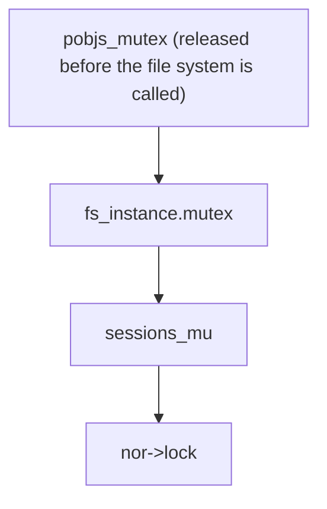

# Concurrency and locking

Which locks serialize storage and flash operations, in what order they are
taken, what runs without a lock and why.

Part of the [SPI-NOR secure storage low-level design](../README.md).

## Execution model

- Storage calls come from TA sessions (syscalls) and from core services (TA
  version database, StandaloneMM, TEE bus enumeration), on any core, in
  thread context. Several threads can be inside the storage code at once.
- The SPI-NOR PTA is `TA_FLAG_CONCURRENT`: several normal-world requests can
  run in parallel.
- Flash probing, GPT reading and the QEMU boot report run once, at
  `driver_init` time, before any TA or normal-world request.
- Nothing in this stack runs in interrupt context; every lock is a sleeping
  `struct mutex`, so a thread may wait for a flash erase (up to 5 s) or, on
  REE FS, an RPC to the normal world while holding one.

## Locks

| Lock | File | Protects | Taken by |
| --- | --- | --- | --- |
| `pobjs_mutex` | `tee_pobj.c` | The list of objects in use, `refcnt`, `creating` | `tee_pobj_get()`, `tee_pobj_release()`, `tee_pobj_create_final()` |
| `pobjs_usage_mutex` | `tee_pobj.c` | `objectUsage` of a shared object (only when opened with a share flag) | open, enumeration, `TEE_RestrictObjectUsage1()` |
| `fs_instance.mutex` (`ree_fs_inst`, `spinor_fs_inst`) | `tee_ree_fs.c` | The cached dirf.db handle and its refcount, every hash tree of the instance, the backend, and for SPI-NOR FS the whole store and the anchor choice (`struct sfs` and `spinor_anchor` have no lock of their own) | Every `tee_file_operations` entry of that instance |
| `sessions_mu` | `core/drivers/spi_nor/rpmc_counter.c` | The RPMC session table: (flash, counter) and session keys | `spi_nor_rpmc_counter_get()`, `spi_nor_rpmc_counter_incr_to()` |
| `nor->lock` | `core/drivers/spi_nor/core.c`, `rpmc.c` | One flash: the command sequence and the `busy` flag | `spi_nor_read()`, `spi_nor_write()`, `spi_nor_erase()`, each RPMC command |
| `counter_mu` | `test_nv_counter.c` | The test NV counter | its two hooks |

## Lock order

A thread only takes a lock lower in this chain while holding a higher one,
never the reverse:

| Path | Locks held, in order |
| --- | --- |
| TA write on SPI-NOR FS, data block | `fs_instance.mutex` → `nor->lock` (inside `spi_nor_write()`), released after each flash call |
| Commit with the RPMC anchor | `fs_instance.mutex` → `sessions_mu` → `nor->lock` (each RPMC command) |
| Commit with the platform counter | `fs_instance.mutex` → the platform's own lock |
| REE FS commit with `CFG_REE_FS_INTEGRITY_RPMC` | REE FS `fs_instance.mutex` → `sessions_mu` → `nor->lock` |
| Normal-world read through the PTA | `nor->lock` only |
| RPMC increment | `nor->lock` held across the Increment command and the read-back, so no other command can come between them |

`nor->lock` is never held while calling up into another layer, and no layer
below `fs_instance.mutex` calls back into the file system, so the chain has
no cycle.

## What can run in parallel

| Pair | Parallel? |
| --- | --- |
| Two operations on SPI-NOR FS (any objects, any TAs) | No: one instance mutex |
| REE FS and SPI-NOR FS | Yes: separate instance mutexes; they meet only at `nor->lock` and `sessions_mu` when REE FS uses an RPMC counter |
| SPI-NOR FS and a normal-world PTA request on another partition of the same flash | Interleaved per flash call: each `spi_nor_*()` call is atomic under `nor->lock`, a whole store operation is not |
| Two flashes | Yes: one `nor->lock` each |

A normal-world erase of up to 64 KiB holds `nor->lock` for as long as the
flash takes to erase it, during which SPI-NOR FS waits.

## What runs without a lock

| Data | Why it is safe | Caveat |
| --- | --- | --- |
| Flash list (`spi_nor_list`) | Filled during `driver_init`, read-only afterwards | |
| Partition list (`part_list` in `partition.c`) | Filled during `driver_init` by the platform, DT or GPT, read-only afterwards | **Exception:** when `optee-fs` comes from `CFG_SPI_NOR_FS_OFFSET/SIZE`, `fs_store_ready()` adds it at the first storage call, at run time. A concurrent PTA request walking the list (`spi_nor_next_partition()`) is not synchronized with that insertion. Low impact (the list only grows, the new entry is never exposed to the normal world) but it should get a lock or be done at init: open item. |
| `nor->geo`, `nor->info` | Written once by `spi_nor_probe()` | |
| `partition->ns_access` | Set at init (DT, QEMU `set_ns_access()`) | |

## Self tests

The store and rollback self tests remount the store. They hold
`spinor_fs_inst.mutex` to check that no dirf.db handle is open, and skip
("storage in use") otherwise. They run from `xtest 1001`, which is not meant
to run in parallel with other storage users.
