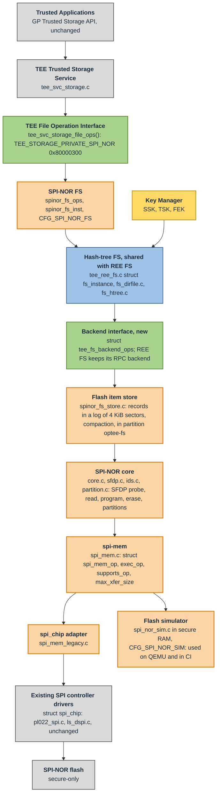
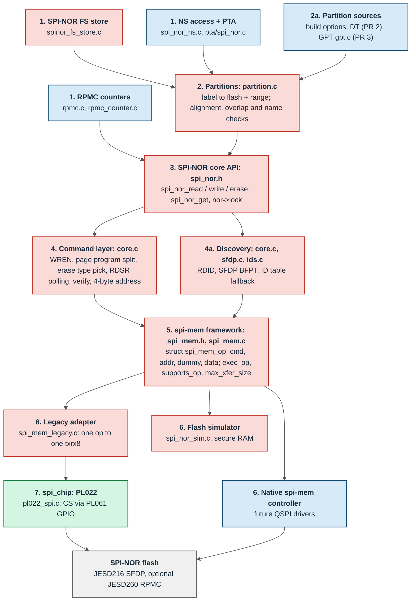
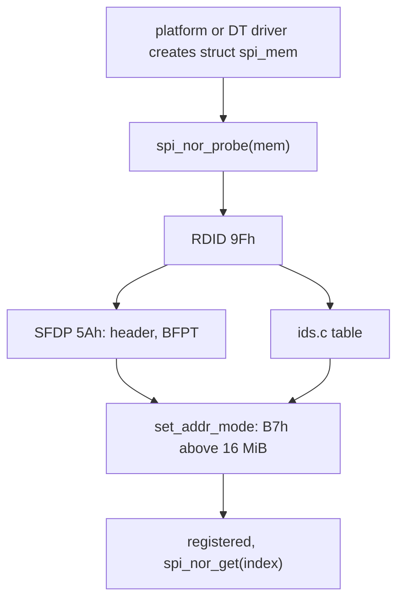

# SPI-NOR driver stack

The SPI-NOR driver is built in seven layers. Each layer talks only to the one
below it, through one interface: users see named partitions and byte ranges,
the core turns those into flash commands, spi-mem carries each command as one
operation, and a controller driver puts it on the wire.

Part of the [SPI-NOR secure storage low-level design](../README.md).

## Zoom from the secure storage overview

The overview figure in [OP-TEE/optee_os#8240](https://github.com/OP-TEE/optee_os/issues/8240)
shows SPI-NOR FS next to REE FS and RPMB FS. This is its SPI-NOR column zoomed
in, limited to what the first pull request (`topic/spinor`) adds:



Colours as in the #8240 figure: grey existing code, blue file system code,
green interfaces, orange added here, yellow keys. Everything from the hash
tree up is shared with REE FS and unchanged; the data path below it never
leaves the secure world (no RPC). Not shown because they come later: the
RPMC rollback anchor next to the hash tree, DT and GPT partition sources next
to the SPI-NOR core.

## Layers



Red boxes are in PR 1 (`topic/spinor`), blue boxes come in later pull requests
or are future work, green is existing upstream code, grey is hardware. RPMC
uses the core API directly: its commands are not reads or writes of a
partition.

## What each layer does

| # | Layer | Files | Interface it offers | What it owns | PR |
| --- | --- | --- | --- | --- | --- |
| 1 | Users | `core/tee/spinor_fs_store.c`; later `spi_nor_ns.c`, `core/pta/spi_nor.c`, `rpmc*.c` | (callers) | Their own on-flash format | 1, later |
| 2 | Partitions | `core/drivers/spi_nor/partition.c` | `spi_nor_add_partition()`, `spi_nor_find_partition()`, `spi_nor_next_partition()`, `spi_nor_del_partition()` | Global list of named ranges; label unique, 1 to 31 characters; erase aligned; inside the flash; no overlap | 1 |
| 2a | Partition sources | build options, `spi_nor_dt_add_partitions()`, `gpt.c` | fill layer 2 | Parsing untrusted tables | 2, 3 |
| 3 | Core API | `core/include/drivers/spi_nor.h`, `core.c` | `spi_nor_probe()`, `spi_nor_get()`, `spi_nor_get_info()`, `spi_nor_read()`, `spi_nor_write()`, `spi_nor_erase()` | Range checks; one `nor->lock` mutex per flash around each call; recovery of a flash left busy | 1 |
| 4 | Command layer | `core.c`, `spi_nor_priv.h` | internal | Turning a byte range into commands: write enable, page-sized programs, erase units, status polling with timeouts, read-back verify | 1 |
| 4a | Discovery | `core.c` (`identify()`), `sfdp.c`, `ids.c` | internal, at probe | Size, page size, erase types and opcodes, address mode; RPMC table (PR 4) | 1 |
| 5 | spi-mem | `core/include/drivers/spi_mem.h`, `core/drivers/spi/spi_mem.c` | `spi_mem_exec_op()`, `spi_mem_supports_op()`, `spi_mem_max_xfer_size()` | One flash command as one operation of up to four phases; bus widths; per-device CS, clock and mode | 1 |
| 6 | Controllers | `spi_mem_legacy.c`, `spi_nor_sim.c`; future native drivers | `struct spi_mem_ctrl_ops`: `exec_op`, `supports_op`, `max_xfer_size` | Putting an operation on a bus, or simulating it | 1 |
| 7 | Bus driver | `core/drivers/pl022_spi.c`, `pl061_gpio.c` (upstream) | `struct spi_chip`: `start`, `txrx8`, `end` | Registers, FIFOs, chip select | upstream |

## Interfaces in detail

### Layer 5: an operation

```c
struct spi_mem_op {
	struct { uint8_t nbytes; uint8_t buswidth; uint16_t opcode; } cmd;
	struct { uint8_t nbytes; uint8_t buswidth; uint64_t val; } addr;
	struct { uint8_t nbytes; uint8_t buswidth; } dummy;
	struct {
		uint8_t buswidth;
		enum spi_mem_data_dir dir;	/* none, in or out */
		size_t nbytes;
		union { void *in; const void *out; } buf;
	} data;
};
```

Every flash command fits this shape: `RDSR` is a 1-byte command with 1 data
byte in, `PP` is a command, a 3- or 4-byte address and up to one page out,
`SE` is a command and an address with no data. The core never deals with chip
select, FIFOs or clocks.

### Layer 6: the legacy adapter

`spi_mem_legacy_get_dev(chip, &mem)` wraps an existing `struct spi_chip`. For
each operation it:

1. builds one transmit buffer: opcode, address bytes (most significant first),
   dummy bytes and, for a write, the data; reads clock out `0xff`;
2. calls `chip->ops->start()` (chip select low), `txrx8()` for the whole
   buffer, then `end()` (chip select high);
3. copies the received data bytes out for a read.

Its buffers are bounded by `SPI_MEM_LEGACY_MAX_XFER` (4 KiB), which it
reports through `max_xfer_size`; the core splits larger reads to fit. Only
single-wire operations are supported.

### Layer 6: the simulator

`spi_nor_sim.c` implements `exec_op` directly on an array in secure RAM, with
NOR semantics (a program only clears bits and wraps inside its page, an
erase sets a whole unit to `0xff`) and an SFDP table. It needs
`CFG_INSECURE=y` and is how CI and the self tests run without hardware.

## A write through the stack

`spi_nor_write(nor, part->offs + 0x1000, buf, 4096)` on a flash with 256-byte
pages, as SPI-NOR FS issues it for one data block:

1. **Layer 2/1**: the store has already turned its sector number into a flash
   offset inside the `optee-fs` partition.
2. **Layer 3**: range check; `mutex_lock(&nor->lock)`; recover the flash if a
   previous command left it busy.
3. **Layer 4**: split into 16 page programs (a page program wraps inside its
   page, so none may cross a page boundary). For each page:
   1. `WREN` (06h);
   2. `PP` (02h), address, 256 data bytes;
   3. poll `RDSR` (05h) until the busy bit clears, with a timeout;
   4. read the page back and compare.
4. **Layer 5**: each of those steps is one `spi_mem_exec_op()`.
5. **Layer 6/7**: the legacy adapter turns each operation into one chip-select
   cycle of `txrx8()` on the PL022.
6. **Layer 3**: `mutex_unlock()`.

An erase goes the same way, using the largest erase type that is aligned and
fits the remaining length (for example a 64 KiB block erase, else 4 KiB
sector erases).

## Probe



The ID table is used only when the flash has no valid SFDP table. Partitions
are added after the probe by the platform, the DT driver or the GPT reader
(see [partitions-gpt.md](partitions-gpt.md)).

## Discovery in detail

### Identification (`identify()`)

1. `RDID` (9Fh) reads 6 bytes into `info.jedec_id`. All zeros or all `0xff`
   in the first three bytes means no flash answered (a floating bus):
   `TEE_ERROR_NOT_SUPPORTED`.
2. `spi_nor_sfdp_parse()` reads the SFDP space with `RDSFDP` (5Ah), always
   with 3 address bytes and 8 dummy clocks.
3. If SFDP is missing or unusable, `spi_nor_ids_lookup()` matches the first
   three ID bytes in `ids.c`. Neither: "unknown flash", `TEE_ERROR_NOT_SUPPORTED`.

### SFDP parsing (`sfdp.c`, JESD216)

| Step | Check |
| --- | --- |
| Header (8 bytes at 0) | Signature `0x50444653` ("SFDP") else `TEE_ERROR_ITEM_NOT_FOUND`; byte 6 = number of parameter headers − 1, at most 8 are read |
| Parameter headers (8 bytes each from offset 8) | ID = byte 7 << 8 \| byte 0; length in dwords = byte 3; table pointer = bytes 4 to 6 |
| BFPT (ID `0xff00`) | Must exist and have at least 9 dwords; up to 16 are read |
| Dword 2: density | Bit 31 clear: size = (value + 1) / 8 bytes; set: size = 2^(value − 3) bytes, value 3 to 66; size 0 is rejected |
| Dwords 8 and 9: erase types | Four (size exponent, opcode) pairs; exponent 0 = unused; kept sorted by size, duplicates dropped |
| Dword 1: 4 KiB erase | Used only if dwords 8/9 give no erase type: bits 1:0 = 01 and opcode in bits 15:8 |
| Dword 1 bits 18:17: address bytes | 00: 3 only; 01: 3 or 4; 10: 4 only; 11: `TEE_ERROR_BAD_FORMAT` |
| Dword 11 bits 7:4: page size | 2^value; 256 bytes if the table has fewer than 11 dwords |
| Sanity | Smallest erase ≤ flash size; page size ≤ smallest erase |
| RPMC table (ID `0xff03`) | Optional; see [rpmc.md](rpmc.md#discovery) |

### ID table (`ids.c`)

Only for parts whose SFDP is missing or wrong. Every entry gets 256-byte
pages and two erase types: 4 KiB (20h) and 64 KiB (D8h).

| Name | JEDEC ID | Size | 4-byte addresses |
| --- | --- | --- | --- |
| w25q128 | ef 40 18 | 16 MiB | no |
| w25q256 | ef 40 19 | 32 MiB | yes |
| mx25l12835f | c2 20 18 | 16 MiB | no |

### Address mode (`set_addr_mode()`)

| Flash size | Address mode |
| --- | --- |
| ≤ 16 MiB | 3 bytes |
| > 16 MiB, SFDP says 4-byte capable | `EN4B` (B7h), then 4 bytes for every command |
| > 16 MiB, 3-byte only | `TEE_ERROR_NOT_SUPPORTED` |

Not yet done: reading SFDP dword 16 for the part's own 4-byte entry method
(some parts need a write enable first, or use dedicated 4-byte opcodes), and
leaving 4-byte mode before a reset hands the flash back to a boot ROM that
expects 3-byte addresses.

### Geometry and info

| Field | Source | Used by |
| --- | --- | --- |
| `geo.size` → `info.size` | density | range checks |
| `geo.page_size` → `info.page_size` | dword 11 | program split |
| `geo.erase[]` (up to 4, sorted) | dwords 8/9 | erase type pick; `info.erase_size` = smallest, the partition alignment unit |
| `geo.addr4_capable` | dword 1 | address mode |
| `geo.rpmc` | RPMC table | RPMC driver |
| `info.jedec_id`, `info.has_sfdp` | RDID, parse result | boot log, RPMC root key |

The boot log line is `SPI-NOR: ef 40 19, 32768 KiB, SFDP` (or `ID table`).

### Timeouts

| Operation | Timeout |
| --- | --- |
| Page program | 10 ms |
| Erase, and recovery of a busy flash | 5 s |
| Register access at probe | 1 ms |
| RPMC command | 5 s |

Status is polled with `RDSR` (05h) until the write-in-progress bit (bit 0)
clears; the last read is taken after the deadline, so a slow but successful
operation is not reported as a timeout.

## Locking and errors

- `nor->lock` serializes every command sequence on one flash; RPMC sessions
  take `sessions_mu` before it (see [concurrency.md](concurrency.md)).
- A command that fails after it may have reached the flash sets `nor->busy`;
  the next call first waits for the flash to become ready
  (`spi_nor_recover()`).
- A program that does not read back as written returns
  `TEE_ERROR_STORAGE_NOT_AVAILABLE`.

## Questions reviewers ask

### Why spi-mem, when OP-TEE already has `struct spi_chip`?

`struct spi_chip` (`core/include/spi.h`) is a full-duplex byte pipe: chip
select through `start()`/`end()`, bytes through `txrx8()`/`txrx16()`. That
fits plain SPI controllers such as PL022 and LS DSPI, the only two that
implement it today, but not the controllers SoCs use for boot flash:

- QSPI/OSPI memory controllers (Cadence QSPI, NXP FlexSPI, ST QUADSPI,
  DesignWare SSI and others) are programmed with a whole command, opcode,
  address, dummy cycles, data and the line count of each phase, and run it
  in hardware. Most cannot keep chip select asserted across separate
  software transfers, so they cannot implement `start()` / `txrx8()` /
  `end()`.
- `struct spi_chip` has no way to describe dual, quad or octal phases.
- Linux and U-Boot put SPI-NOR on spi-mem for these reasons; the same shape
  keeps their controller drivers and flash quirks easy to port.

spi-mem does not replace `struct spi_chip`. Non-memory SPI devices keep
using it, and existing controllers work with SPI-NOR unchanged through the
adapter, which turns each operation into one `start` / `txrx8` / `end`
cycle. The cost is about 110 lines of framework and a 137-line adapter,
behind `CFG_DRIVERS_SPI_MEM` (default `n`).

### Can any SPI controller use it?

Any controller that drives SPI memories, yes. A driver implements one
mandatory and two optional callbacks:

| Callback | Required | Purpose |
| --- | --- | --- |
| `exec_op(mem, op)` | yes | Run one operation |
| `supports_op(mem, op)` | no | Refuse a combination the hardware cannot do |
| `max_xfer_size(mem)` | no | Largest data phase; the SPI-NOR core splits longer reads |

The framework validates every operation before a driver sees it (1 to 2
command bytes, up to 8 address bytes, bus widths 1/2/4/8, a buffer that
matches the data direction) and checks it against the lines the device is
wired with and the controller's transfer limit. Chip select, clock, mode
and bus widths are per device (`struct spi_mem`), so one controller can
serve several flashes.

| Controller | How it plugs in |
| --- | --- |
| Plain SPI with `struct spi_chip` | The adapter, no new code (single line, 4 KiB per operation) |
| QSPI/OSPI memory controller | A native driver: `exec_op` programs its command registers |
| Simulated flash | `spi_nor_sim.c` implements `exec_op` |

Not covered yet: memory-mapped (direct-mapping) reads, DTR, and non-memory
SPI devices, which stay on `struct spi_chip`. The SPI-NOR core issues only
single-line operations so far; wider ones are validated by the framework but
not yet driven by a real controller. These would be added as optional
callbacks, without changing `exec_op`.
