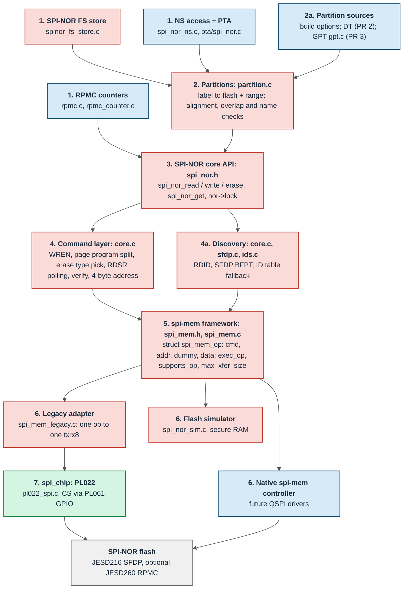
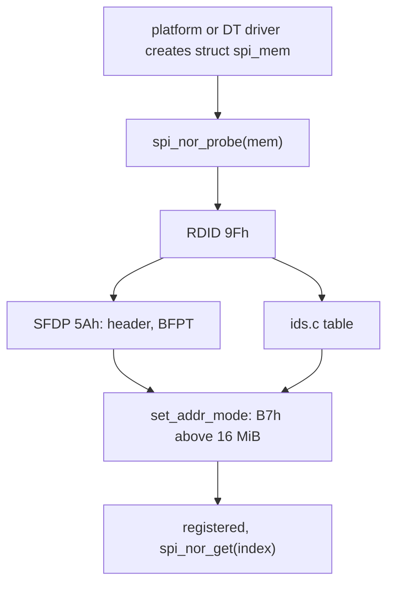

# SPI-NOR driver stack

The SPI-NOR driver is built in seven layers. Each layer talks only to the one
below it, through one interface: users see named partitions and byte ranges,
the core turns those into flash commands, spi-mem carries each command as one
operation, and a controller driver puts it on the wire.

Part of the [SPI-NOR secure storage low-level design](../README.md).

## Layers



Red boxes are in PR 1 (`topic/spinor`), blue boxes come in later pull requests
or are future work, green is existing upstream code, grey is hardware. RPMC
uses the core API directly: its commands are not reads or writes of a
partition.

## What each layer does

| # | Layer | Files | Interface it offers | What it owns | PR |
| --- | --- | --- | --- | --- | --- |
| 1 | Users | `core/tee/spinor_fs_store.c`; later `spi_nor_ns.c`, `core/pta/spi_nor.c`, `rpmc*.c` | (callers) | Their own on-flash format | 1, later |
| 2 | Partitions | `core/drivers/spi_nor/partition.c` | `spi_nor_add_partition()`, `spi_nor_find_partition()`, `spi_nor_next_partition()`, `spi_nor_del_partition()` | Global list of named ranges; label unique, 1 to 31 characters; erase aligned; inside the flash; no overlap | 1 |
| 2a | Partition sources | build options, `spi_nor_dt_add_partitions()`, `gpt.c` | fill layer 2 | Parsing untrusted tables | 2, 3 |
| 3 | Core API | `core/include/drivers/spi_nor.h`, `core.c` | `spi_nor_probe()`, `spi_nor_get()`, `spi_nor_get_info()`, `spi_nor_read()`, `spi_nor_write()`, `spi_nor_erase()` | Range checks; one `nor->lock` mutex per flash around each call; recovery of a flash left busy | 1 |
| 4 | Command layer | `core.c`, `spi_nor_priv.h` | internal | Turning a byte range into commands: write enable, page-sized programs, erase units, status polling with timeouts, read-back verify | 1 |
| 4a | Discovery | `core.c` (`identify()`), `sfdp.c`, `ids.c` | internal, at probe | Size, page size, erase types and opcodes, address mode; RPMC table (PR 4) | 1 |
| 5 | spi-mem | `core/include/drivers/spi_mem.h`, `core/drivers/spi/spi_mem.c` | `spi_mem_exec_op()`, `spi_mem_supports_op()`, `spi_mem_max_xfer_size()` | One flash command as one operation of up to four phases; bus widths; per-device CS, clock and mode | 1 |
| 6 | Controllers | `spi_mem_legacy.c`, `spi_nor_sim.c`; future native drivers | `struct spi_mem_ctrl_ops`: `exec_op`, `supports_op`, `max_xfer_size` | Putting an operation on a bus, or simulating it | 1 |
| 7 | Bus driver | `core/drivers/pl022_spi.c`, `pl061_gpio.c` (upstream) | `struct spi_chip`: `start`, `txrx8`, `end` | Registers, FIFOs, chip select | upstream |

## Interfaces in detail

### Layer 5: an operation

```c
struct spi_mem_op {
	struct { uint8_t nbytes; uint8_t buswidth; uint16_t opcode; } cmd;
	struct { uint8_t nbytes; uint8_t buswidth; uint64_t val; } addr;
	struct { uint8_t nbytes; uint8_t buswidth; } dummy;
	struct {
		uint8_t buswidth;
		enum spi_mem_data_dir dir;	/* none, in or out */
		size_t nbytes;
		union { void *in; const void *out; } buf;
	} data;
};
```

Every flash command fits this shape: `RDSR` is a 1-byte command with 1 data
byte in, `PP` is a command, a 3- or 4-byte address and up to one page out,
`SE` is a command and an address with no data. The core never deals with chip
select, FIFOs or clocks.

### Layer 6: the legacy adapter

`spi_mem_legacy_get_dev(chip, &mem)` wraps an existing `struct spi_chip`. For
each operation it:

1. builds one transmit buffer: opcode, address bytes (most significant first),
   dummy bytes and, for a write, the data; reads clock out `0xff`;
2. calls `chip->ops->start()` (chip select low), `txrx8()` for the whole
   buffer, then `end()` (chip select high);
3. copies the received data bytes out for a read.

Its buffers are bounded by `SPI_MEM_LEGACY_MAX_XFER` (4 KiB), which it
reports through `max_xfer_size`; the core splits larger reads to fit. Only
single-wire operations are supported.

### Layer 6: the simulator

`spi_nor_sim.c` implements `exec_op` directly on an array in secure RAM, with
NOR semantics (a program only clears bits and wraps inside its page, an
erase sets a whole unit to `0xff`) and an SFDP table. It needs
`CFG_INSECURE=y` and is how CI and the self tests run without hardware.

## A write through the stack

`spi_nor_write(nor, part->offs + 0x1000, buf, 4096)` on a flash with 256-byte
pages, as SPI-NOR FS issues it for one data block:

1. **Layer 2/1**: the store has already turned its sector number into a flash
   offset inside the `optee-fs` partition.
2. **Layer 3**: range check; `mutex_lock(&nor->lock)`; recover the flash if a
   previous command left it busy.
3. **Layer 4**: split into 16 page programs (a page program wraps inside its
   page, so none may cross a page boundary). For each page:
   1. `WREN` (06h);
   2. `PP` (02h), address, 256 data bytes;
   3. poll `RDSR` (05h) until the busy bit clears, with a timeout;
   4. read the page back and compare.
4. **Layer 5**: each of those steps is one `spi_mem_exec_op()`.
5. **Layer 6/7**: the legacy adapter turns each operation into one chip-select
   cycle of `txrx8()` on the PL022.
6. **Layer 3**: `mutex_unlock()`.

An erase goes the same way, using the largest erase type that is aligned and
fits the remaining length (for example a 64 KiB block erase, else 4 KiB
sector erases).

## Probe



The ID table is used only when the flash has no valid SFDP table. Partitions
are added after the probe by the platform, the DT driver or the GPT reader
(see [partitions-gpt.md](partitions-gpt.md)).

## Locking and errors

- `nor->lock` serializes every command sequence on one flash; RPMC sessions
  take `sessions_mu` before it (see [concurrency.md](concurrency.md)).
- A command that fails after it may have reached the flash sets `nor->busy`;
  the next call first waits for the flash to become ready
  (`spi_nor_recover()`).
- A program that does not read back as written returns
  `TEE_ERROR_STORAGE_NOT_AVAILABLE`.
