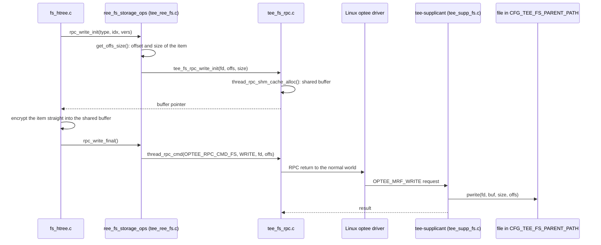

# File systems

What a TA gets, which file systems OP-TEE implements, and the internals of the hash-tree file system, its REE FS backend and RPMB FS.

Part of the [SPI-NOR secure storage low-level design](../README.md).

## What a TA gets: objects, not POSIX files

OP-TEE gives TAs no POSIX file interface: there is no open(), read(), mkdir() or opendir() for files in a TA, and no directories. A TA uses the GlobalPlatform TEE Internal Core API "Trusted Storage": it stores persistent objects, each named by an object ID of up to 64 arbitrary bytes, in a flat namespace private to that TA. The POSIX file system people often have in mind is on the other side: with REE FS, tee-supplicant in Linux stores OP-TEE's encrypted files on the normal world's ext4 or similar, under /var/lib/tee.

| What a TA wants | POSIX | What OP-TEE offers (GP API) |
| --- | --- | --- |
| Create a file | open(O_CREAT) | TEE_CreatePersistentObject(storageID, objectID, flags, attributes, initial data) |
| Open an existing file | open() | TEE_OpenPersistentObject(storageID, objectID, flags) |
| Read, write, seek | read(), write(), lseek() | TEE_ReadObjectData(), TEE_WriteObjectData(), TEE_SeekObjectData() |
| Change the size | ftruncate() | TEE_TruncateObjectData() |
| Rename | rename() | TEE_RenamePersistentObject(), within the same TA |
| Delete | unlink() | TEE_CloseAndDeletePersistentObject1() |
| List files | opendir(), readdir() | TEE_AllocatePersistentObjectEnumerator(), TEE_StartPersistentObjectEnumerator(), TEE_GetNextPersistentObject(): every object of the TA, no order, no filter |
| Folders | mkdir() | none |
| Permissions, owner, timestamps | chmod(), stat() | none; only the TA that created an object can see it, and objectUsage restricts what a key object may be used for |
| Sharing between processes | file locks | access and share flags on open (TEE_DATA_FLAG_SHARE_READ, SHARE_WRITE); no sharing between TAs |
| Durability | fsync() | none needed: every create, write, truncate, rename and remove is atomic and durable when the call returns |

An object is more than a byte stream: it carries a type and attributes (a key object stores its key material there) next to its data stream. A TA that wants paths can put "/" in its object IDs, but OP-TEE treats them as plain bytes: "a/b" and "a/c" have nothing in common, there is no "a" to create or list, and renaming "a" renames nothing else.

The flat design fits what secure storage is for: a few keys, certificates and small state records per TA. It keeps every object's integrity and identity check to one dirf.db entry, and lets the GP API give whole-object atomicity that POSIX does not.

libutils has a sys/fcntl.h with O_\* flag values, but TAs have no file functions that use them.

## Which file system is implemented

OP-TEE does not use a general-purpose file system such as FAT, ext4 or LittleFS. It has two file systems of its own: the **hash-tree file system** (core/tee/tee_ree_fs.c, fs_dirfile.c, fs_htree.c), behind both REE FS and SPI-NOR FS, and **RPMB FS** (core/tee/tee_rpmb_fs.c), a small FAT-like file system inside the eMMC or UFS RPMB partition. SPI-NOR FS adds a third layer under the hash-tree file system: a log-structured flash store (core/tee/spinor_fs_store.c) that takes the place of the normal world's files.

|  | Hash-tree FS on REE FS | Hash-tree FS on SPI-NOR FS | RPMB FS |
| --- | --- | --- | --- |
| Kind | flat, encrypted, authenticated object store: one index file + one file per object | same file system, on a log-structured flash store | flat FAT-like file system with one contiguous extent per file |
| Namespace | dirf.db maps (TA UUID, object ID) to a file number | same | file name "/\<TA UUID in hex>/\<object ID in hex>" in the FAT entry, up to 224 bytes |
| Directory structure | one directory file, dirf.db: an array of 120-byte entries | same | the FAT: a list of 256-byte entries from byte 512 of the partition |
| File structure | binary hash tree of 4 KiB encrypted blocks, two versions of every item | same | one run of 256-byte RPMB half-sectors, located by start_address and data_size |
| Media below | files on the normal world's file system, through tee-supplicant | 4 KiB sectors of a SPI-NOR partition: log sectors and data sectors | the RPMB partition, through authenticated frames routed by tee-supplicant or the kernel |
| Encryption | AES-128-GCM per block, a random FEK per file | same | AES-128-CBC with ESSIV per 256-byte block, a random FEK per file kept in its FAT entry |
| Integrity | GCM tags + SHA-256 hash tree, root hash in dirf.db | same | the RPMB device's HMAC-SHA256 on every frame; the data itself carries no tag |
| Atomic update | out-of-place: write the inactive version, then the head | same; the store appends records and never overwrites | in place when the write fits one atomic RPMB write, else copy the whole file to a new extent, then rewrite its FAT entry |
| Rollback protection | needs an anchor: RPMB hash or NV counter | needs an anchor: RPMC or NV counter | built in: the RPMB write counter |
| Closest familiar design | an encrypted Merkle-tree store, as in dm-verity or a git object store | the same on top of a flash log, as in JFFS2 or the log of LittleFS | the root directory of FAT, without clusters or a cluster chain |

The sections below describe the hash-tree file system (dirf.db, the hash tree) and its REE FS backend, then RPMB FS; the SPI-NOR backend is in [spinor-store.md](spinor-store.md).

## Directory file dirf.db

dirf.db is itself a hash-tree file whose data stream is an array of fixed-size entries, one per stored object of every TA. Committing dirf.db is the single atomic step that makes a create, write, rename or remove take effect, because each entry carries the object's root hash.

### Entry format (`struct dirfile_entry`, `core/tee/fs_dirfile.c`)

| Field | Size | Meaning |
| --- | --- | --- |
| `uuid` | 16 | owning TA |
| `oid` | 64 | object ID (`TEE_OBJECT_ID_MAX_LEN`) |
| `oidlen` | 4 | 0 with `oid[0] == 1` (`OID_EMPTY_NAME`) is a valid empty ID; 0 with `oid[0] == 0` is a free slot |
| `hash` | 32 | SHA-256 root hash of the object's hash tree at its last commit |
| `file_number` | 4 | backend file name: printed in hex by `tee_fs_dirfile_fileh_to_fname()`, e.g. `/var/lib/tee/1f` for REE FS |

An entry is 120 bytes; entry *n* is at byte *n* × 120 of the data stream. dirf.db's own hash tree is opened with no TA UUID, so its FEK is wrapped with a key derived from a dummy byte instead of a TA UUID (see [Keys and crypto](integrity.md#keys-and-crypto)).

### Operations

| Function | What it does | Committed by |
| --- | --- | --- |
| `tee_fs_dirfile_open()` | opens or creates dirf.db (with the expected root hash, or the minimum counter from the anchor), reads every entry and builds the `files` bitmap of used file numbers; a duplicate file number is cleared | n/a |
| `tee_fs_dirfile_get_tmp()` | lowest free file number, marked used; the entry is written later | the caller's commit |
| `tee_fs_dirfile_find()` | linear scan for (uuid, oid) | n/a |
| `tee_fs_dirfile_rename()` | writes an entry at a given or new index with a new oid and the file's hash | `fs->commit_dirh_writes()` |
| `tee_fs_dirfile_update_hash()` | rewrites only the `hash` field of an entry after an object changed | `fs->commit_dirh_writes()` |
| `tee_fs_dirfile_remove()` | zeroes the entry and frees the file number | `fs->commit_dirh_writes()` |
| `tee_fs_dirfile_commit_writes()` | syncs dirf.db's hash tree, returns its root hash and head counter | then the instance raises the anchor |

### Order of a remove

`fs_remove()` zeroes the entry, commits dirf.db, and only then removes the object's file through `be->remove()`. A power cut between the two leaves an unreferenced file, never a dirent pointing at a missing file. Create and overwrite (`set_name()`) follow the same rule: new file first, dirent switch and commit, old file removed last.

### The cached handle

`get_dirh()` opens dirf.db on first use and caches it in `fs->dirh` with a reference count; `put_dirh()` drops the reference and closes the handle at zero, or at once when an operation failed (its in-memory tree may no longer match storage). An open object holds a reference from `fs_open()` until `ree_fs_close()`, so dirf.db stays open while any object is open.

## Hash tree (fs_htree)

Every file (each object and dirf.db) is a binary hash tree of 4 KiB encrypted data blocks, kept in two versions per item. Writing the head with a higher counter is the commit point: until then the old head, and through it the old tree, stays valid.

### Items

| Item | Struct | Size | Contents |
| --- | --- | --- | --- |
| Head, versions 0 and 1 | `struct tee_fs_htree_image` | 68 bytes | `iv[16]`, `tag[16]`, `enc_fek[16]`, `imeta[16]` (encrypted `struct tee_fs_htree_imeta`: `meta.length` + `max_node_id`), `counter` |
| Node *n* ≥ 1, versions 0 and 1 | `struct tee_fs_htree_node_image` | 66 bytes | `hash[32]`, `iv[16]`, `tag[16]` (GCM tag of block *n* − 1), `flags` |
| Block *b* ≥ 0, versions 0 and 1 | ciphertext | 4096 bytes | AES-GCM of the plaintext block with the file's FEK and the node's IV |

Node *n* covers block *n* − 1 (`BLOCK_NUM_TO_NODE_ID`). Its children are nodes 2*n* and 2*n* + 1 (`get_node()`: the parent of *n* is *n* >> 1), so node 1 is the root and the tree grows as blocks are added. `imeta` is 16 bytes because `struct tee_fs_htree_imeta` (a `uint64_t` length and a `uint32_t`) is padded to 8-byte alignment.

### What each value protects

| Value | Computed in | Over |
| --- | --- | --- |
| Block ciphertext + node `tag` | `tee_fs_htree_write_block()` → `authenc_init()` | plaintext block; AAD = `enc_fek` + node `iv` |
| Node `hash` | `calc_node_hash()` | `iv`, `tag`, `flags` of the node, `meta` for the root only, then the hashes of child 0 and child 1 |
| Head `tag` | `update_root()` | encrypted `imeta`; AAD = root node hash, `counter`, `enc_fek`, head `iv` |
| Dirent `hash` (in dirf.db) | copied from the root node hash at `tee_fs_htree_sync_to_storage()` | the whole tree, transitively |

A changed block changes its node's tag, so its hash, so every ancestor's hash, so the root hash, which the head tag and the dirent both bind. Each new encryption takes a fresh random IV.

### Which version is current

| Item | Current version chosen by |
| --- | --- |
| Head | `get_idx_from_counter()`: the slot with the higher counter, parity-checked (`init_head_from_data()`), or the one whose root node matches the dirent hash when the caller has one |
| Root node | lowest bit of the head counter: version `!(counter & 1)` is written before the counter is raised |
| Node *n* > 1 | parent's `flags` bit `HTREE_NODE_COMMITTED_CHILD(n & 1)` |
| Block | own node's `flags` bit `HTREE_NODE_COMMITTED_BLOCK` |

### Commit sequence (`tee_fs_htree_sync_to_storage()`)

1. Each `tee_fs_htree_write_block()` flips its node's `COMMITTED_BLOCK` bit once per sync and writes the block to the other version.
2. A post-order walk (`htree_traverse_post_order()` with `htree_sync_node_to_storage()`) visits every dirty node, children first: it flips the node's bit in its parent, recomputes the node hash and writes the node to its new version.
3. The root is written to version `!(counter & 1)`, with `meta` in its hash.
4. `update_root()` increments `counter` and re-encrypts `imeta` into the head with a new tag.
5. The head is written to slot `counter & 1`: this is the commit.
6. The new root hash (and counter) is returned to the caller, which stores it in dirf.db (objects) or in the anchor (dirf.db).

An error anywhere in the sequence closes the tree (`tee_fs_htree_close()`); the next open reads the last committed state.

### Open and verify (`tee_fs_htree_open()`)

- With an expected root hash (objects): read root node versions 0 and 1 until one matches the dirent hash, then the head in the same slot.
- Without one (dirf.db): read both heads and pick one by counter; the counter must be at least `min_counter` (the anchor), else `TEE_ERROR_SECURITY`.
- `verify_root()` unwraps the FEK and checks the head tag; `init_tree_from_data()` loads the committed node versions; `verify_tree()` recomputes every node hash. Blocks are checked lazily, by their GCM tag, when read.
- A head with counter 0 and an all-zero tag is a creation cut by power loss: dirf.db is created again (`ht_head_is_partially_done()`).

`create_and_sync()` starts a new tree; on topic/rpmc it starts the head counter at `min_counter` and writes the dummy head to the other slot (commit "core: fs_htree: start a new hash tree above the minimum counter").

## REE FS backend

REE FS stores every hash-tree file as a plain file in the normal world: OP-TEE computes each item's file offset and sends read and write requests to tee-supplicant over RPC, with the encrypted bytes in shared memory. The normal world only ever sees ciphertext, but it can delete or replace files, which is what the anchor guards against.

### Request path

| RPC (`OPTEE_RPC_FS_*`) | Sent by | tee-supplicant | Parameters |
| --- | --- | --- | --- |
| `OPEN`, `CREATE` | `tee_fs_rpc_open_dfh()`, `tee_fs_rpc_create_dfh()` | `open()` of `<parent>/<name>` | name `"/dirf.db"` or `"/<file number in hex>"` in shared memory; returns an fd |
| `READ`, `WRITE` | `tee_fs_rpc_read_init/final()`, `tee_fs_rpc_write_init/final()` | `pread()`, `pwrite()` | fd, offset, buffer |
| `TRUNCATE` | `ree_fs_rpc_truncate()` | `ftruncate()` | fd, length |
| `REMOVE` | `ree_fs_rpc_remove()` | `unlink()` | name |
| `CLOSE` | `ree_fs_rpc_close()` | `close()` | fd |
| `OPENDIR`, `READDIR`, `CLOSEDIR` | `ree_fs_opendir_rpc()` and friends | directory listing | used to enumerate TA objects |

The parent directory is `CFG_TEE_FS_PARENT_PATH` of optee_client (default `/var/lib/tee`).

### File layout (`get_offs_size()`)

Items are packed in 4 KiB physical blocks of the REE file. With 66-byte nodes, one node block holds 31 nodes × 2 versions, followed by those 31 data blocks × 2 versions.

| Physical block | Content |
| --- | --- |
| 0 | head version 0 at offset 0, head version 1 right after it |
| 1 | nodes 1 to 31 (blocks 0 to 30), versions 0 and 1 interleaved, 66 bytes each |
| 2, 3 | data block 0, versions 0 and 1 |
| … | … |
| 62, 63 | data block 30, versions 0 and 1 |
| 64 | nodes 32 to 62 (blocks 31 to 61) |
| 65, 66 | data block 31, versions 0 and 1 |

The comment in `get_offs_size()` numbers nodes from 0 there; in this table they are numbered as in the hash tree (node *n* = block *n* − 1). A truncate to *n* blocks cuts the file at data block *n*'s offset; on topic/spinor this happens after the commit (commit "core: tee_ree_fs: truncate the stored file after the commit").

## RPMB FS internals

RPMB FS (core/tee/tee_rpmb_fs.c) is a separate, much simpler file system: a 128-byte partition header, a FAT of 256-byte file entries growing up from byte 512, and file data packed down from the top of the RPMB partition, one contiguous extent per file. It has no hash tree: integrity and freshness come from the RPMB device itself, which accepts a write only with a valid HMAC and the next write counter value.

### Layout

| RPMB byte address | Content | Struct |
| --- | --- | --- |
| 0–127 | partition header: rpmb_fs_magic 0x52504d42 ("RPMB"), fs_version 2, write_counter, fat_start_address (512), 112 reserved bytes | struct rpmb_fs_partition |
| 512, 768, 1024, … | FAT: one 256-byte entry per file; the entry with FILE_IS_LAST_ENTRY ends the list | struct rpmb_fat_entry |
| top of the partition, downwards | file data, each file one contiguous run of 256-byte RPMB blocks | allocated with tee_mm, TEE_MM_POOL_HI_ALLOC |

The FAT grows up and the data grows down, so the free space is the gap between them.

### FAT entry (struct rpmb_fat_entry, 256 bytes)

| Field | Size | Meaning |
| --- | --- | --- |
| start_address | 4 | byte address of the file's data |
| data_size | 4 | file length in bytes |
| flags | 4 | FILE_IS_ACTIVE (bit 0): entry in use; FILE_IS_LAST_ENTRY (bit 1): end of the FAT |
| unused | 4 |  |
| fek | 16 | the file's random FEK, wrapped with the TA's TSK (tee_fs_generate_fek()) |
| filename | 224 | "/" + TA UUID in hex + "/" + object ID in hex (create_filename()); a "." before the object ID marks an object still being created |

File names and sizes are stored in clear: anyone who can read the RPMB partition, which needs no key, can see which TAs store objects and the object IDs they use. Only the data is encrypted.

### Operations

- **Mount** (rpmb_fs_setup(), first use): read the header, then write it back once to raise the write counter, so a request held back by an attacker can no longer be replayed. A missing or reset header (CFG_RPMB_RESET_FAT) formats the partition: "\*\*\*\* Clearing Storage \*\*\*\*", a new header and a FAT of one last entry. A different fs_version fails with TEE_ERROR_ACCESS_DENIED.
- **Lookup** (read_fat()): walk the FAT from byte 512 and compare filename strings with strcmp(), so every open is a linear scan of the FAT (sped up by CFG_RPMB_FS_CACHE_ENTRIES).
- **Allocation**: for a write, read_fat() also adds every active file's extent and the FAT itself to a fresh tee_mm pool, then tee_mm_alloc() finds a free run from the top. There is no free-space map on the media.
- **Write** (rpmb_fs_write_primitive()): if the write stays inside the file and needs no more blocks than one reliable RPMB write covers (rel_wr_blkcnt), it is done in place. Otherwise the whole file is copied to a new extent with the change applied, and then the FAT entry is rewritten to point at it; the FAT entry write is the commit.
- **Create**: a new or reused inactive FAT entry; if it was the last one, a new last entry is written after it.
- **Remove**: the 256-byte FAT entry is zeroed; its extent becomes free at the next allocation scan.
- **Encryption**: each 256-byte block is AES-128-CBC with an ESSIV IV, AES-ECB of the block index under SHA-256(FEK) (tee_fs_crypt_block() in tee_fs_key_manager.c).

### Limits

- No fragmentation handling: a file must fit in one free run, so a full or fragmented partition fails with TEE_ERROR_STORAGE_NO_SPACE although enough blocks are free in total.
- Growing a file rewrites all of it, so the cost of a write grows with the file size.
- RPMB partitions are small, typically 128 KiB to 16 MiB, and the write counter stops the device for good after 2^32 − 1 writes.

