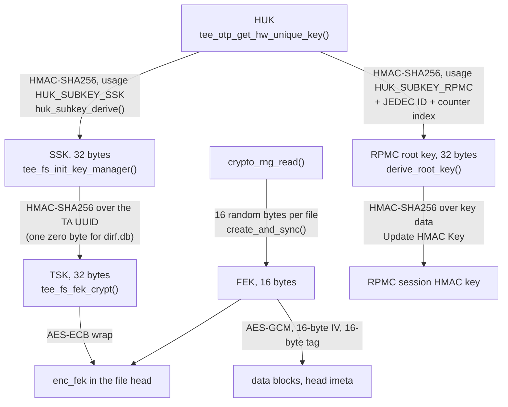
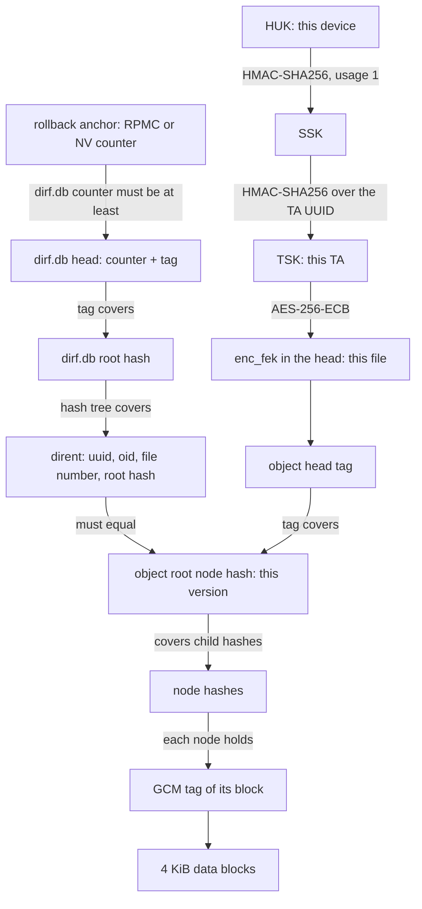

# Keys, integrity and identity

How confidentiality, integrity and identity are enforced, down to the exact bytes each key, tag and hash covers.

Part of the [SPI-NOR secure storage low-level design](../README.md).

## Keys and crypto

One device key (HUK) gives one storage key (SSK), one key per TA (TSK), and a random key per file (FEK). Only the FEK touches data, and it is stored only wrapped by the TSK, so a file is readable only by the TA that owns it, on the device that wrote it.

| Key | Size | Derived in | Stored | Used for |
| --- | --- | --- | --- | --- |
| HUK | platform | `tee_otp_get_hw_unique_key()` (platform hook) | hardware | input to every subkey |
| SSK | 32 | `huk_subkey_derive(HUK_SUBKEY_SSK)` at boot | secure RAM only | deriving TSKs |
| TSK | 32 | `do_hmac(SSK, TA UUID)` in `tee_fs_fek_crypt()`, on every wrap or unwrap | never | wrapping the FEK (`TEE_FS_KM_ENC_FEK_ALG`, AES-ECB) |
| FEK | 16 | random, when a file's tree is created | wrapped, in `tee_fs_htree_image.enc_fek` | AES-GCM of blocks and head `imeta` (`TEE_FS_HTREE_AUTH_ENC_ALG`) |
| RPMC root key | 32 | `huk_subkey_derive(HUK_SUBKEY_RPMC, JEDEC ID, counter)` | in the flash, written once at provisioning | signing Update HMAC Key |
| RPMC HMAC key | 32 | HMAC(root key, random key data) per session | secure RAM, `rpmc_counter.c` sessions | signing counter requests and checking replies |

All hashes are SHA-256 (`TEE_FS_HTREE_HASH_ALG`). With `CFG_CORE_HUK_SUBKEY_COMPAT=y`, the SSK keeps the older derivation from the chip ID (`huk_compat()`) so existing storage stays readable.

## Integrity and identity

Every byte read back is checked against a chain that ends in one of two trusted values: the root hash that dirf.db holds for each object, and the rollback anchor that pins dirf.db itself. Identity (which device, which TA, which object, which version) is not a field that is compared on its own: it is folded into the keys and hashes, so a wrong identity shows up as a failed tag or hash.

### What binds what

The anchor and the HUK are the only values the attacker cannot rewrite. Everything else is on disk or flash and is trusted only because a value above it in this chain vouches for it.

### Byte layout of the checked items

| Item | Bytes | Clear or encrypted |
| --- | --- | --- |
| Head, 68 bytes (struct tee_fs_htree_image) | 0–15 iv · 16–31 tag · 32–47 enc_fek · 48–63 imeta · 64–67 counter | imeta encrypted (meta.length uint64_t, max_node_id uint32_t, 4 bytes padding); counter in clear, covered by the tag |
| Node, 66 bytes (struct tee_fs_htree_node_image) | 0–31 hash · 32–47 iv · 48–63 tag · 64–65 flags | all in clear, covered by the node hash; flags bit 0 = committed version of the block, bit 1 = of child 2n, bit 2 = of child 2n + 1 |
| Data block, 4096 bytes | ciphertext only | encrypted; its tag is in its node |
| dirent, 120 bytes (struct dirfile_entry) | 0–15 uuid · 16–79 oid · 80–83 oidlen · 84–115 root hash · 116–119 file_number | encrypted, as data of dirf.db's own hash tree |

Integers are stored in CPU byte order (little-endian on Arm), so the format is not portable across byte orders.

### Exact inputs of each key, tag and hash

| Value | Algorithm, key | Input bytes, in order | Code |
| --- | --- | --- | --- |
| SSK (32 bytes) | HMAC-SHA256, key = HUK (16 bytes) | usage HUK_SUBKEY_SSK = 1 as a 4-byte uint32_t; with CFG_CORE_HUK_SUBKEY_COMPAT=y the die ID (get_otp_die_id()) followed by the string "ONLY_FOR_tee_fs_ssk" instead | __huk_subkey_derive(), tee_fs_init_key_manager() |
| TSK (32 bytes) | HMAC-SHA256, key = SSK | the TA's TEE_UUID as it is in memory (16 bytes); for dirf.db one byte 0x00, so it can never equal a TA's | tee_fs_fek_crypt(): recomputed on every wrap and unwrap, then wiped |
| enc_fek (16 bytes) | AES-256-ECB, key = TSK | the FEK, one AES block | tee_fs_fek_crypt() |
| Block ciphertext + tag | AES-128-GCM, key = FEK, IV = node.iv (16 random bytes, new on every write) | AAD = enc_fek (16) ‖ node.iv (16); plaintext = the 4096-byte block; tag (16) goes to node.tag | authenc_init(ni), tee_fs_htree_write_block() |
| Node hash | SHA-256 | node bytes 32–65 (iv, tag, flags: 34 bytes) ‖ meta.length (8, root only) ‖ hash of child 2n (32, if it exists) ‖ hash of child 2n + 1 (32, if it exists) | calc_node_hash() |
| Head tag | AES-128-GCM, key = FEK, IV = head.iv (16 random bytes) | AAD = root node hash (32) ‖ counter (4) ‖ enc_fek (16) ‖ head.iv (16); plaintext = imeta (16); tag (16) goes to head.tag | authenc_init(NULL), update_root() |
| dirent hash | copy | the object's root node hash after its last sync | tee_fs_htree_sync_to_storage() → tee_fs_dirfile_update_hash() |

With CFG_REE_FS_HTREE_HASH_SIZE_COMPAT=y only the first 16 bytes of the root hash go into the head AAD, for storage written by old OP-TEE versions.

### How each identity is enforced

- **Device**: the SSK comes from the HUK. On another device every FEK unwraps to a wrong key, so the first head tag check (verify_root()) fails.
- **TA**: the TSK is per TA UUID. dirf.db lookups match the uuid field (tee_fs_dirfile_find(), and tee_fs_dirfile_get_next() for enumeration), and a file's FEK unwraps only with its TA's TSK. A dirent edited to point at another TA's file still fails the head tag.
- **Object ID**: a file does not carry its object ID. The binding is the dirent, (uuid, oid) → file number + root hash, so two files of one TA swapped on disk each have a root hash that matches neither dirent.
- **Version**: the dirent hash pins one exact version of the object; the anchor pins the newest dirf.db.
- **Position of a block**: the block's GCM AAD has no block number or file ID. The block is bound to its place because its tag is stored in node n, whose hash is in its parent's hash, up to the root.

### Check order at open and read

1. dirf.db, on the first call of the instance (get_dirh()): both heads are read. get_idx_from_counter() accepts slot 0 only with an even counter and slot 1 only with an odd one, and takes the higher if both are valid; neither valid is TEE_ERROR_SECURITY. A counter below the anchor is TEE_ERROR_SECURITY.
2. verify_root(): unwrap the FEK with the TSK, decrypt imeta and check the head tag, which binds the root hash and the counter. Failure is TEE_ERROR_CORRUPT_OBJECT.
3. init_tree_from_data(): for nodes 2 to max_node_id, read the version that the parent's flags name.
4. verify_tree(): recompute every node hash, children first, and compare it with consttime_memcmp(). Failure is TEE_ERROR_CORRUPT_OBJECT.
5. tee_fs_dirfile_open() reads every dirent; a file number used twice is cleared in the later entry, which is written back.
6. Object open: tee_fs_dirfile_find() gives the file number and root hash. Root node version 0, then version 1, is read until its hash equals the dirent hash; the head in the same slot is used, and steps 2 to 4 run for the object.
7. Each block read: SPI-NOR FS first compares the CRC-32 of the sector with the record's data_crc (a media check), then the block is decrypted and its GCM tag checked against the node.

An open reads and hashes every node of the file, so its cost grows with the file size; data blocks are checked only when they are read.

### Tamper and fault matrix

| Change to the stored bytes | Detected by | Result |
| --- | --- | --- |
| One bit of a data block | GCM tag in tee_fs_htree_read_block(); on SPI-NOR the data_crc first | read fails with TEE_ERROR_CORRUPT_OBJECT; the object is removed (remove_corrupt_obj()) and the handle closed, unless the TA has TA_FLAG_DONT_CLOSE_HANDLE_ON_CORRUPT_OBJECT |
| Two blocks of one file swapped | GCM tag: each tag is in the other block's node | same |
| A node's iv, tag or flags | verify_tree() at open | open fails with TEE_ERROR_CORRUPT_OBJECT; the object is removed |
| A node and its stored hash, both | the parent's hash, up to the root and the dirent | same |
| The head's imeta or counter | head tag in verify_root() | same |
| Object file replaced by an older copy of itself | root hash ≠ dirent hash in init_head_from_data() | same |
| Object file replaced by another object's file, same or other TA | root hash ≠ dirent hash; another TA's file also fails the FEK unwrap | same |
| Object file deleted (REE FS) | be->open() returns TEE_ERROR_ITEM_NOT_FOUND, which fs_open() turns into TEE_ERROR_CORRUPT_OBJECT | same |
| dirf.db and all objects rolled back together | dirf.db counter < anchor | TEE_ERROR_SECURITY on every call of that instance; nothing is removed |
| dirf.db deleted while the anchor is above 0 | open_dirh() / spinor_open_dirh() | TEE_ERROR_SECURITY, unless CFG_REE_FS_ALLOW_RESET / CFG_SPI_NOR_FS_ALLOW_RESET starts over |
| dirf.db corrupted while the anchor is 0 | head tag or tree check | ree_fs_open_primitive() removes the corrupt dirf.db, and the next call creates an empty one: every object of every TA is lost |
| Whole store copied to another device | wrong SSK: the dirf.db head tag fails | dirf.db does not open; with the anchor at 0 it is removed as in the row above |
| SPI-NOR: the bytes of one record | record CRC at mount: the record is skipped and its sector closed for appending | the item's previous record is used, and the hash tree and the anchor judge it as an older copy |
| SPI-NOR: two block records on one data sector | drop_stale_blocks() at mount | the older one is dropped; its object then fails as corrupt when read |
| SPI-NOR: a block record pointing at a log sector | scan() | the block is dropped; it reads short, which is TEE_ERROR_CORRUPT_OBJECT |

The CRC-32s of SPI-NOR FS only catch torn writes and media errors: anyone who can write the flash can recompute them. Security rests on the hash tree and the anchor alone. On REE FS the normal world can make every change in this table; on SPI-NOR FS only someone with physical access to the flash can.

