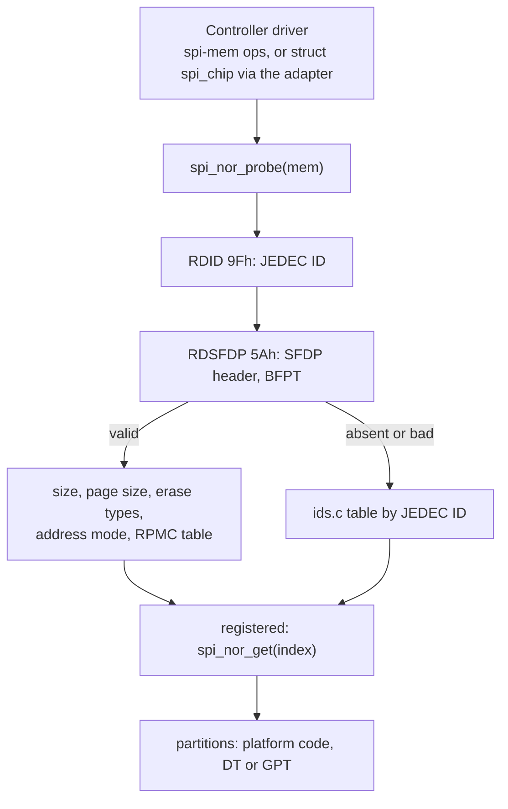

# Flash discovery, partitions and normal-world access

How OP-TEE finds a SPI-NOR flash, splits it into named partitions (from
build options, the secure DT or a GPT on the flash), and which partitions the
normal world may reach.

Part of the [SPI-NOR secure storage low-level design](../README.md).

## Flash discovery



| Step | Code | Detail |
| --- | --- | --- |
| Probe | `spi_nor_probe()` in `core/drivers/spi_nor/core.c` | Called by platform code (QEMU: `spi_nor_qemu.c`), or by the DT driver for `jedec,spi-nor` nodes (PR 2) |
| Identify | `sfdp.c`, `ids.c` | SFDP first (JESD216: BFPT for size, page, erase types, 3/4-byte address); the ID table is the fallback |
| Commands | `spi_nor_priv.h` | 03h read, 02h page program, the 4 KiB erase opcode from SFDP, 05h status polling, 06h write enable, B7h enter 4-byte mode above 16 MiB |
| Index | `spi_nor_get(index)` | Flashes are numbered in probe order; `CFG_SPI_NOR_FS_DEVICE` selects one by that index |
| Lock | `nor->lock` | One mutex per flash around every command sequence |

## Partitions

A partition is a named, erase-aligned range of one flash
(`struct spi_nor_partition` in `core/include/drivers/spi_nor.h`).

| Field | Meaning |
| --- | --- |
| `nor` | The flash |
| `label` | Unique name, 1 to 31 characters (`SPI_NOR_PART_LABEL_LEN` = 32 with the NUL) |
| `offs`, `size` | Byte range; both multiples of the flash's smallest erase unit; inside the flash; size not zero |
| `ns_access` | `SPI_NOR_NS_ACCESS_NONE`, `_RO` or `_RW` |

`spi_nor_add_partition()` (`partition.c`) rejects a partition that breaks the
rules above, whose label is already used, or that overlaps another partition
of the same flash. Partitions are kept in one global list
(`spi_nor_find_partition()`, `spi_nor_next_partition()`,
`spi_nor_del_partition()`).

Well-known labels:

| Label | Used by |
| --- | --- |
| `optee-fs` | SPI-NOR FS store; never accessible to the normal world |
| `boot`, `kernel`, `ns-data` | QEMU example layout |

### Sources of partitions

| Source | When | Code | NS access from |
| --- | --- | --- | --- |
| Build options | No DT partition, no GPT | `CFG_SPI_NOR_FS_OFFSET/SIZE` registered as `optee-fs` by `fs_store_ready()`; QEMU: `CFG_QEMU_SPI_NOR_*` table | none (store), QEMU table |
| Secure DT | A `partitions` subnode under the flash node (PR 2) | `spi_nor_dt_add_partitions()` | `optee,ns-access` property |
| GPT on the flash | `CFG_SPI_NOR_GPT=y` and the DT flash node has no `partitions` subnode (hook commit), or platform code calls `spi_nor_gpt_add_partitions()` (QEMU) | `gpt.c` | Platform code by label (QEMU: `set_ns_access()`); GPT attributes are not used |

On QEMU the order is: GPT first; if the flash has none
(`TEE_ERROR_ITEM_NOT_FOUND`) or GPT support is off, the built-in table. The
boot log names the source ("GPT partitions:" or "built-in partitions:") and
reports each partition's content.

### Device tree binding

```dts
spi-nor@0 {
    compatible = "jedec,spi-nor";
    reg = <0>;

    partitions {
        #address-cells = <1>;
        #size-cells = <1>;

        boot@100000 {
            label = "boot";
            reg = <0x100000 0x100000>;
            optee,ns-access = "ro";
        };
        optee-fs@1000000 {
            label = "optee-fs";
            reg = <0x1000000 0x100000>;
            optee,rollback-anchor = "rpmc";
        };
    };
};
```

| Property | Node | Values | Meaning |
| --- | --- | --- | --- |
| `label` | partition | string | Partition name; the node name if absent |
| `reg` | partition | offset, size (1 or 2 cells each) | Byte range |
| `optee,ns-access` | partition | `"none"` (default), `"ro"`, `"rw"` | Normal-world access |
| `optee,rollback-anchor` | `optee-fs` partition | `"auto"`, `"rpmc"`, `"nv-counter"` | Overrides `CFG_SPI_NOR_FS_ANCHOR` |
| `status = "disabled"` | partition | | Skipped |

A malformed partition node makes the whole flash lose its DT partitions (all
or nothing). A DT that declares `optee-fs` while no flash has it makes the
storage unavailable rather than falling back to the build options.

## GUID partition table parser

`core/drivers/spi_nor/gpt.c` reads a GPT as defined in UEFI 2.10 section 5.3.
The table comes from the flash, so it is parsed as untrusted input.

### Layout on a flash (512-byte blocks)

| LBA | Content |
| --- | --- |
| 0 | Protective MBR |
| 1 | Primary GPT header |
| 2 to 33 | Primary partition entries (128 entries of 128 bytes) |
| … | Partitions |
| last − 32 to last − 1 | Backup partition entries |
| last | Backup GPT header |

Block sizes of 512 and 4096 bytes are probed (`gpt_block_sizes[]`).

### Checks on a header (`read_header()`)

1. Signature `"EFI PART"` (`0x5452415020494645`); absent means no GPT
   (`TEE_ERROR_ITEM_NOT_FOUND`).
2. Header size 92 bytes to one block; CRC32 over the header with its CRC
   field zeroed; major revision 1; `MyLBA` equals the block it was read from.
3. Entry size a power of two from 128 bytes to one block; the entry array at
   most 64 KiB and inside the disk.
4. The usable range, the header and the entry array do not overlap and lie
   inside the flash.

Any failure after step 1 is `TEE_ERROR_CORRUPT_OBJECT`.

### Entries (`read_entries()`, `add_entry()`)

- The entry array is read block by block; its CRC32 is computed incrementally
  and compared with the header's.
- Unused entries (zero type GUID) and entries without a name are skipped.
- An entry must lie inside the usable range. Its name (UTF-16LE, 36 code
  units) must be printable ASCII and shorter than the partition label limit.
- Each entry becomes a partition through `spi_nor_add_partition()`, so
  alignment, overlap and duplicate-name checks apply.

### Primary and backup

`find_table()` tries the primary header at LBA 1 and, if it is bad, the backup
at the last block ("bad primary GPT, using backup"). The result is all or
nothing: if any entry fails, every partition added from that table is removed
again (`spi_nor_gpt_add()`). The log line is:

```
I/TC: SPI-NOR: primary GPT, 512-byte blocks, 4 of 128 entries
```

### Known limits

- An entry that is not erase aligned rejects the whole table (open item 2 in
  [02-scope-of-work.md](../02-scope-of-work.md#23-open-items)).
- On a DT flash without partitions, a GPT error fails the flash probe, which
  panics the boot (open item 1).
- Only names are used; partition type GUIDs and attribute bits are ignored.
- The normal world must not be able to write the GPT sectors
  ([AS-LAY-02](../04-assumptions.md#43-partitions-and-layout)).

### Host verification

About 633,000 mutated tables were run through the parser on the host under
AddressSanitizer and UBSan: no memory errors, no reads outside the flash, and
no partitions left behind by a rejected table.

## Normal-world access

With `CFG_SPI_NOR_NS_ACCESS=y`, partitions whose access is `RO` or `RW` are
exposed; all others, `optee-fs` included, are invisible to the normal world.
`CFG_SPI_NOR_PTA=y` adds the front-end.

### Policy (`core/drivers/spi_nor/spi_nor_ns.c`)

| Check | Rule |
| --- | --- |
| Partition ID | Index among exposed partitions only; others are `TEE_ERROR_ITEM_NOT_FOUND` |
| Range | Length not zero, offset and length inside the partition |
| Size | Read and program at most 4 KiB per call; erase at most 64 KiB |
| Access | Program and erase need `RW`, else `TEE_ERROR_ACCESS_DENIED` |
| Erase alignment | Offset and length multiples of the erase unit |
| Buffers | Data is copied through a secure bounce buffer; the flash is never accessed from shared memory |

Program needs the range to be erased first, as on any NOR flash.

### SPI-NOR PTA (`core/pta/spi_nor.c`, `lib/libutee/include/pta_spi_nor.h`)

| Command | ID | Parameters | Result |
| --- | --- | --- | --- |
| `PTA_SPI_NOR_CMD_GET_INFO` | 0 | out memref: array of `struct pta_spi_nor_part` (id, access, size, erase size, page size, label) | `TEE_ERROR_SHORT_BUFFER` with the needed size |
| `PTA_SPI_NOR_CMD_READ` | 1 | value: partition ID, offset; out memref: data (≤ 4 KiB) | |
| `PTA_SPI_NOR_CMD_WRITE` | 2 | value: partition ID, offset; in memref: data (≤ 4 KiB) | `TEE_ERROR_ACCESS_DENIED` on a read-only partition |
| `PTA_SPI_NOR_CMD_ERASE` | 3 | value: partition ID, offset, length (≤ 64 KiB) | |

Only sessions from the REE kernel (`TEE_LOGIN_REE_KERNEL`) are accepted. The
PTA is flagged `TA_FLAG_DEVICE_ENUM`, so the TEE bus enumerates it without
tee-supplicant. Whether this interface is proposed upstream is to be agreed
in #8240.
