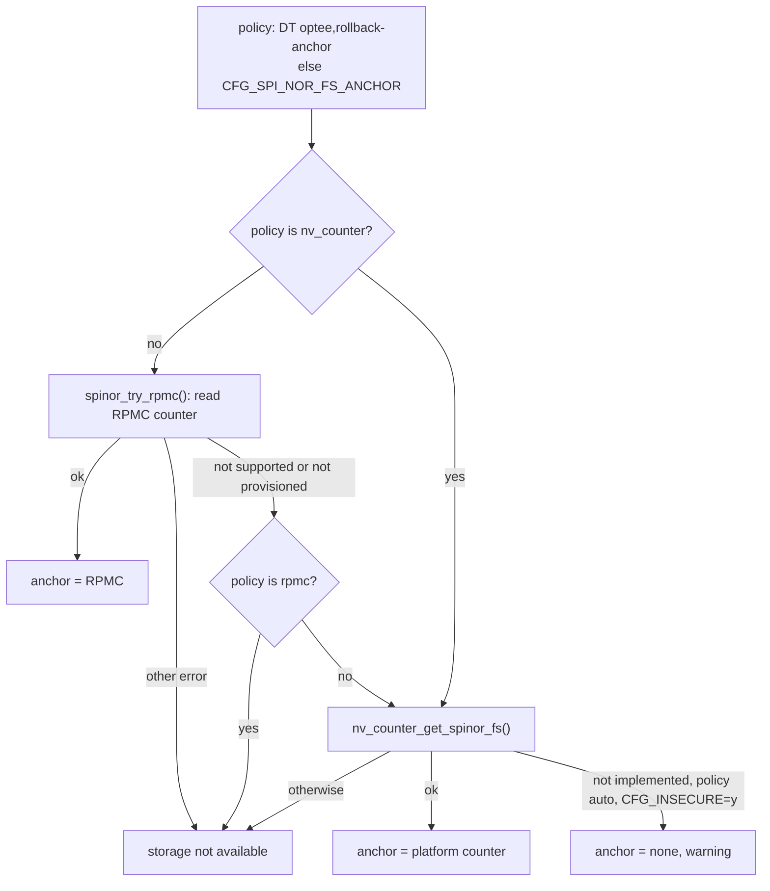

# Rollback protection

How an older copy of the storage is detected, the anchors that make it possible and how SPI-NOR FS selects one.

Part of the [SPI-NOR secure storage low-level design](../README.md).

## Rollback protection

The hash tree proves that a file is a version this device wrote, not that it is the latest one. Freshness comes from comparing dirf.db's head counter with an anchor the attacker cannot rewind: at open, the counter must be at least the anchor, and every commit raises the anchor to the new counter.

### Anchors

| File system | Anchor | Build option | Read at open | Raised at commit |
| --- | --- | --- | --- | --- |
| REE FS | RPMB file `dirfile.db.hash` holding dirf.db's root hash | `CFG_REE_FS_INTEGRITY_RPMB` (default = `CFG_RPMB_FS`) | `open_dirh()`: dirf.db opened with that exact hash | `commit_dirh_writes()`: new hash written to RPMB |
| REE FS | platform monotonic counter | weak `nv_counter_get_ree_fs()` / `nv_counter_incr_ree_fs_to()` overridden by the platform | `open_dirh()`: `min_counter` | `nv_counter_incr_ree_fs_to(counter)` |
| REE FS | RPMC counter `CFG_REE_FS_RPMC_COUNTER` of a SPI-NOR flash | `CFG_REE_FS_INTEGRITY_RPMC` | as the platform counter (implements the hooks) | same |
| SPI-NOR FS | RPMC counter `CFG_SPI_NOR_FS_RPMC_COUNTER` of the store's flash | `CFG_SPI_NOR_RPMC`, policy `auto` or `rpmc` | `spinor_open_dirh()` → `spinor_anchor_get()` | `spinor_commit_dirh_writes()` → `spinor_anchor_incr_to()` |
| SPI-NOR FS | platform counter | weak `nv_counter_get_spinor_fs()` / `nv_counter_incr_spinor_fs_to()`, policy `auto` or `nv_counter` | same | same |
| either | none | only with `CFG_INSECURE=y` | counter 0, warning printed | nothing |

### SPI-NOR FS anchor selection (`spinor_select_anchor()`, once per boot)

A counter that answers but misbehaves (bad signature, timeout) never falls back to a weaker anchor. Products exposed to physical attacks should pin `rpmc` in the DT: with `auto`, swapping the flash for one without RPMC selects the platform counter.

### Checks

1. Open: `tee_fs_dirfile_open(false, NULL, min_counter)` picks the dirf.db head by counter and fails with `TEE_ERROR_SECURITY` if it is below `min_counter` (`init_head_from_data()`). The log says "dirf.db is older than the rollback anchor".
2. dirf.db missing while the anchor is non-zero: `TEE_ERROR_SECURITY`, unless `CFG_REE_FS_ALLOW_RESET` / `CFG_SPI_NOR_FS_ALLOW_RESET` lets it start over at the anchor's value.
3. Commit: `tee_fs_dirfile_commit_writes()` returns the new head counter; the instance raises the anchor to it. `spi_nor_rpmc_counter_incr_to()` issues one RPMC increment per step, each signed with the session HMAC key and checked against the counter it read.

The anchor is raised after dirf.db is durable. If power is cut between the two, the anchor lags one commit, and the image from just before that commit would still be accepted until the next commit (a review finding, not fixed yet).

### RPMC in brief (JEDEC JESD260)

| Command (OP1 `0x9b`) | Signed with | OP-TEE function |
| --- | --- | --- |
| Write Root Key | truncated HMAC of the packet with the root key; the key itself travels in clear | `spi_nor_rpmc_write_root_key()`, only with `CFG_RPMC_WRITE_ROOT_KEY` and only when the flash reports no root key |
| Update HMAC Key | HMAC(root key, key data) | `spi_nor_rpmc_update_hmac_key()` at session start |
| Increment Counter | HMAC key, over the current counter value | `spi_nor_rpmc_increment()` |
| Request Counter | HMAC key; reply = tag + counter + signature, read with OP2 `0x96` | `spi_nor_rpmc_read()`: random 12-byte tag, signature checked with `consttime_memcmp()` |

