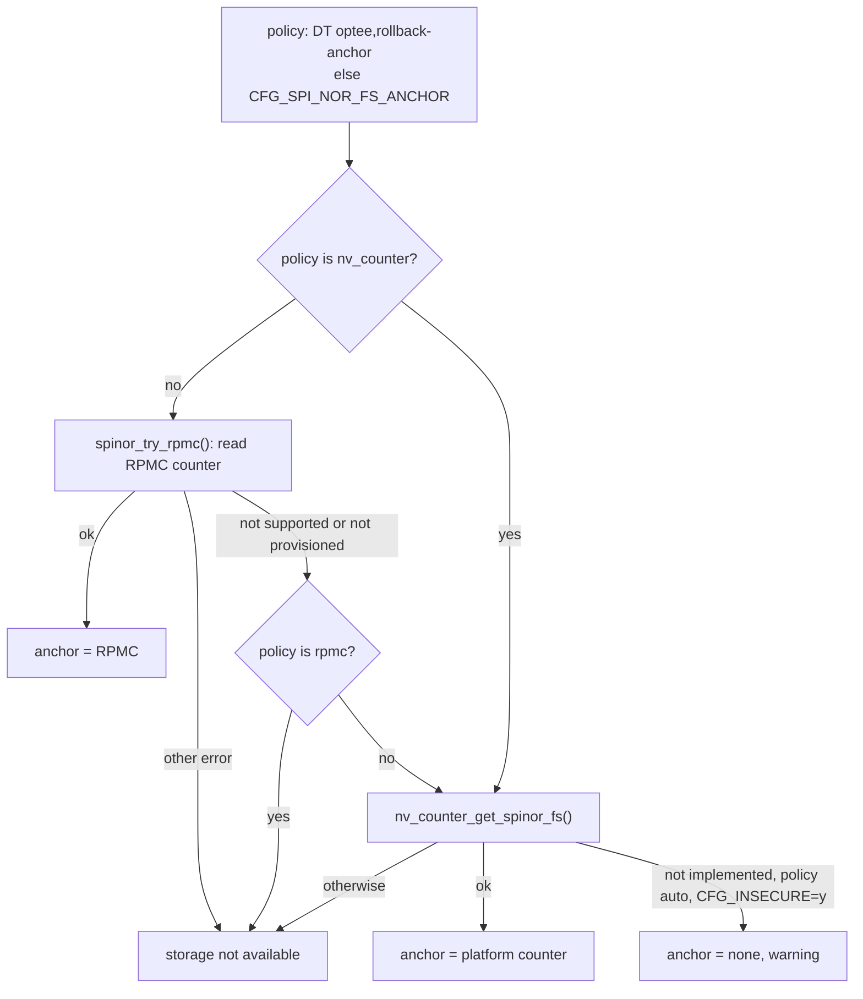
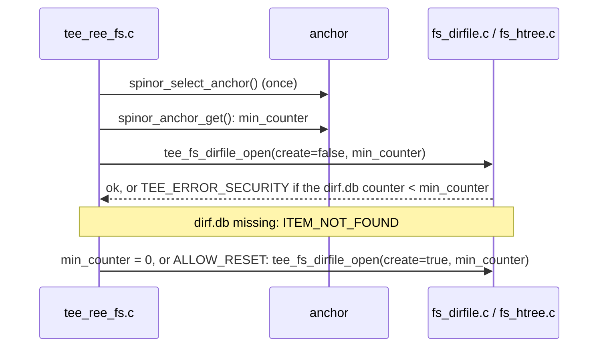
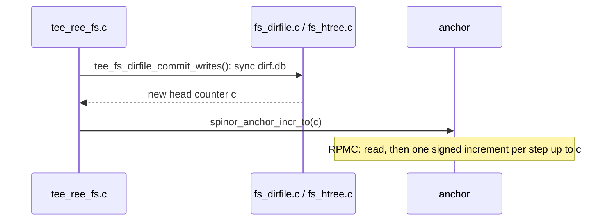

# Rollback protection

How an older copy of the storage is detected, the anchors that make it possible and how SPI-NOR FS selects one.

Part of the [SPI-NOR secure storage low-level design](../README.md).

## Rollback protection

The hash tree proves that a file is a version this device wrote, not that it is the latest one. Freshness comes from comparing dirf.db's head counter with an anchor the attacker cannot rewind: at open, the counter must be at least the anchor, and every commit raises the anchor to the new counter.

### Anchors

| File system | Anchor | Build option | Read at open | Raised at commit |
| --- | --- | --- | --- | --- |
| REE FS | RPMB file `dirfile.db.hash` holding dirf.db's root hash | `CFG_REE_FS_INTEGRITY_RPMB` (default = `CFG_RPMB_FS`) | `open_dirh()`: dirf.db opened with that exact hash | `commit_dirh_writes()`: new hash written to RPMB |
| REE FS | platform monotonic counter | weak `nv_counter_get_ree_fs()` / `nv_counter_incr_ree_fs_to()` overridden by the platform | `open_dirh()`: `min_counter` | `nv_counter_incr_ree_fs_to(counter)` |
| REE FS | RPMC counter `CFG_REE_FS_RPMC_COUNTER` of a SPI-NOR flash | `CFG_REE_FS_INTEGRITY_RPMC` | as the platform counter (implements the hooks) | same |
| SPI-NOR FS | RPMC counter `CFG_SPI_NOR_FS_RPMC_COUNTER` of the store's flash | `CFG_SPI_NOR_RPMC`, policy `auto` or `rpmc` | `spinor_open_dirh()` → `spinor_anchor_get()` | `spinor_commit_dirh_writes()` → `spinor_anchor_incr_to()` |
| SPI-NOR FS | platform counter | weak `nv_counter_get_spinor_fs()` / `nv_counter_incr_spinor_fs_to()`, policy `auto` or `nv_counter` | same | same |
| either | none | only with `CFG_INSECURE=y` | counter 0, warning printed | nothing |

### SPI-NOR FS anchor selection (`spinor_select_anchor()`, once per boot)

`spinor_try_rpmc()` treats `TEE_ERROR_NOT_SUPPORTED` (no RPMC) and `TEE_ERROR_BAD_STATE` (not provisioned) as "no RPMC". A counter that answers but misbehaves (bad signature, timeout) never falls back to a weaker anchor. Products exposed to physical attacks should pin `rpmc` in the DT: with `auto`, swapping the flash for one without RPMC selects the platform counter.

### Checks

1. Open: `tee_fs_dirfile_open(false, NULL, min_counter)` picks the dirf.db head by counter and fails with `TEE_ERROR_SECURITY` if it is below `min_counter` (`init_head_from_data()`). The log says "dirf.db is older than the rollback anchor".
2. dirf.db missing while the anchor is non-zero: `TEE_ERROR_SECURITY`, unless `CFG_REE_FS_ALLOW_RESET` / `CFG_SPI_NOR_FS_ALLOW_RESET` lets it start over at the anchor's value.
3. Commit: `tee_fs_dirfile_commit_writes()` returns the new head counter; the instance raises the anchor to it. `spi_nor_rpmc_counter_incr_to()` issues one RPMC increment per step, each signed with the session HMAC key and checked against the counter it read.

The anchor is raised after dirf.db is durable. If power is cut between the two, the anchor lags one commit, and the image from just before that commit would still be accepted until the next commit (a review finding, not fixed yet).

## Policy

| Policy (`CFG_SPI_NOR_FS_ANCHOR`, or DT `optee,rollback-anchor` on the `optee-fs` partition) | RPMC present and provisioned | No RPMC, platform counter | Neither |
| --- | --- | --- | --- |
| `auto` (default) | RPMC | platform counter | none, only with `CFG_INSECURE=y`; else unavailable |
| `rpmc` | RPMC | unavailable | unavailable |
| `nv_counter` (DT: `nv-counter`) | platform counter (RPMC not used) | platform counter | unavailable |

The DT value wins over the build option; an unknown DT value is
`TEE_ERROR_BAD_FORMAT` ("bad optee,rollback-anchor"). The choice is made once
per boot, at the first storage call, and kept in `spinor_anchor`.

## Sequences

### Open (first storage call after boot)

| Case | Result | Log |
| --- | --- | --- |
| dirf.db counter ≥ anchor | mounted | |
| dirf.db counter < anchor | `TEE_ERROR_SECURITY` on every call | "SPI-NOR FS: dirf.db is older than the rollback anchor" |
| dirf.db missing, anchor 0 | new empty dirf.db | |
| dirf.db missing, anchor > 0 | `TEE_ERROR_SECURITY` | "SPI-NOR FS: dirf.db not found" |
| same, `CFG_SPI_NOR_FS_ALLOW_RESET=y` | new empty dirf.db starting at the anchor's value | "dirf.db not found, starting over at counter N" |

A reset needs the new tree's first head to be above the anchor.
`create_and_sync()` therefore starts the head counter at `min_counter` and
writes the dummy head to the other slot (commit "core: fs_htree: start a new
hash tree above the minimum counter"); before that fix, a reset with a
non-zero anchor left a dirf.db that failed the next mount.

### Commit (every create, write, truncate, rename, remove)

The head counter grows by one per commit, so the anchor normally moves one
step per commit. If raising the anchor fails, the call returns the error,
but dirf.db is already committed.

## The one-commit gap

The anchor is raised after dirf.db is durable. A power cut between the two
leaves:

| | dirf.db head | anchor |
| --- | --- | --- |
| before the commit | c − 1 | c − 1 |
| after the cut | c | c − 1 |

At the next boot the current image (c) mounts, as it should, but a saved
image from just before the commit (c − 1) would mount too, until the next
commit raises the anchor to c + 1. Raising the anchor first would close the
gap at the cost of refusing the old image when the commit itself is cut;
this is an open item (RSK-01 in [04-assumptions.md](../04-assumptions.md#46-risks-and-open-questions)).

## Platform counter contract

`core/include/kernel/nv_counter.h`:

| Function | Contract |
| --- | --- |
| `nv_counter_get_spinor_fs(uint32_t *value)` | Current value; `TEE_ERROR_NOT_IMPLEMENTED` if the platform has none (weak default) |
| `nv_counter_incr_spinor_fs_to(uint32_t value)` | Raise to `value` if lower; never decrease; durable before it returns |

The counter must survive power loss and be out of the attacker's reach (for
example fuses, a secure element or another RPMB). `CFG_SPI_NOR_TEST_NV_COUNTER`
implements the hooks in secure RAM for tests only: it resets at boot, so it
detects replay within one boot only, and it needs `CFG_INSECURE=y`.

## RPMC as the REE FS anchor

`CFG_REE_FS_INTEGRITY_RPMC` implements `nv_counter_get_ree_fs()` and
`nv_counter_incr_ree_fs_to()` with RPMC counter `CFG_REE_FS_RPMC_COUNTER`
(default 1) of the first flash that has it. REE FS then gets the same
protection on products with a SPI-NOR flash and no RPMB. It excludes
`CFG_REE_FS_INTEGRITY_RPMB`. REE FS and SPI-NOR FS must use different
counters.

## RPMC

The commands, packets, keys and sessions are described in
[rpmc.md](rpmc.md).

## Tests

| Test | What it checks |
| --- | --- |
| `spinor_fs_rollback_self_test()` (`xtest 1001`, simulator) | Write an object with value 1, snapshot the simulated flash, write value 2, swap the snapshot back in and remount: with an anchor the read fails with `TEE_ERROR_SECURITY`; without one it succeeds, which the test expects as the known gap. Then the current image is restored and must read 2. Skipped if the store is in use. |
| QEMU four-boot run (flash and RPMC images kept between boots) | A: fresh flash, storage tests; B: remount and run again; C: an older flash image put back, the storage must be refused; D: the current image restored, storage works again |
| `test_rpmc()` | The RPMC layer; see [rpmc.md](rpmc.md) |
