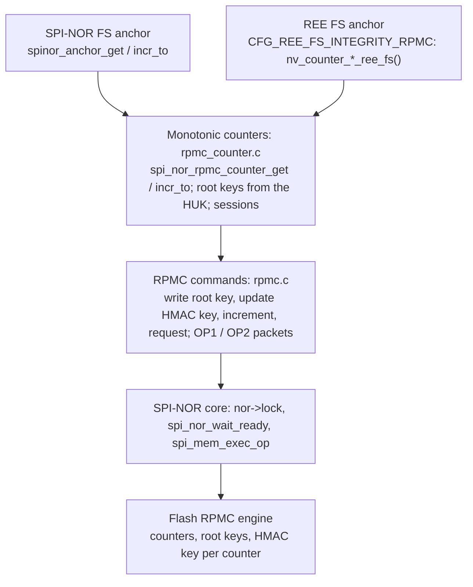
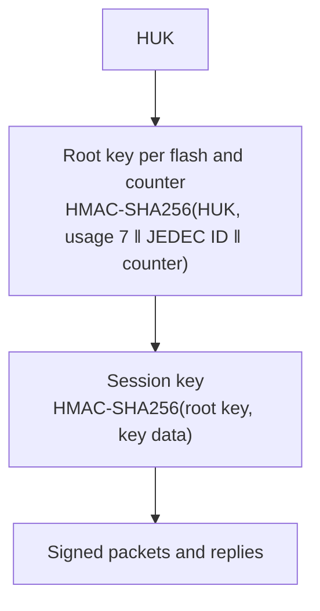

# RPMC driver

The Replay Protected Monotonic Counters (RPMC) of a SPI-NOR flash, as
defined by JEDEC JESD260 and described in its SFDP RPMC parameter table. OP-TEE
uses them as monotonic counters that an attacker who can rewrite the flash
still cannot roll back: every counter request and update is signed with a
key that only this device can derive.

Part of the [SPI-NOR secure storage low-level design](../README.md). Code:
`core/drivers/spi_nor/rpmc.c` (commands), `rpmc_counter.c` (keys, sessions,
monotonic counters), `core/include/drivers/spi_nor_rpmc.h`. Options:
`CFG_SPI_NOR_RPMC`, `CFG_RPMC_WRITE_ROOT_KEY` (PR 4).

## Layers

## Discovery

`parse_rpmc()` in `sfdp.c` reads the SFDP parameter table with ID `0xff03`
(2 dwords). Dword 1:

| Bits | Field | Use |
| --- | --- | --- |
| 0 | Flash hardening flavour | 1 (no hardening) is not supported: RPMC is left off |
| 1 | Counter size | Ignored: the packets always carry 32-bit counters |
| 2 | Busy polling | 0: poll with OP2 extended status; 1: poll the status register |
| 7:4 | Number of counters − 1 | `geo.rpmc.num_counters` |
| 15:8 | OP1 | Opcode that sends a command packet |
| 23:16 | OP2 | Opcode that reads extended status and replies |

A missing or unusable table leaves `num_counters` at 0: the flash works, every
RPMC call returns `TEE_ERROR_NOT_SUPPORTED`.

## Commands (`rpmc.c`)

Every command is one OP1 operation whose data is a packet that starts with
the same 4-byte header, followed by an OP2 status read.

| Header byte | Value |
| --- | --- |
| 0 | OP1 (sent as the command byte) |
| 1 | command type |
| 2 | counter address (0 to `num_counters` − 1) |
| 3 | 0 (reserved) |

### Packets

| Command | Type | Packet after the header | Signature |
| --- | --- | --- | --- |
| Write Root Key | 0 | root key (32) ‖ truncated signature (28) | HMAC-SHA256(root key, header), last 28 bytes |
| Update HMAC Key | 1 | key data (4, big-endian) ‖ signature (32) | HMAC-SHA256(session key, header ‖ key data), where session key = HMAC-SHA256(root key, key data) |
| Increment Counter | 2 | current counter value (4, big-endian) ‖ signature (32) | HMAC-SHA256(session key, header ‖ counter) |
| Request Counter | 3 | tag (12 random bytes) ‖ signature (32) | HMAC-SHA256(session key, header ‖ tag) |

### Completion and status

After the OP1 operation the flash is busy. `wait_done()` waits up to 5 s:

- by polling OP2 + 1 dummy byte until extended status bit 0 (busy) clears,
  or
- if the SFDP table says so, by polling the status register
  (`spi_nor_wait_ready()`), then reading the extended status once with OP2.

| Extended status | Meaning in OP-TEE |
| --- | --- |
| `0x80` (bit 7 only) | Success |
| `0x02` after Update HMAC Key | Counter has no root key: `TEE_ERROR_ITEM_NOT_FOUND` |
| anything else | `TEE_ERROR_BAD_STATE` (wrong signature, wrong counter value, no session key) |
| still busy after 5 s | `TEE_ERROR_STORAGE_NOT_AVAILABLE`, flash marked busy |

### Reading a counter (`read_locked()`)

1. Send Request Counter with a fresh 12-byte random tag.
2. Read the reply with OP2 + 1 dummy byte: status (1) ‖ tag (12) ‖ counter
   (4, big-endian) ‖ signature (32), 49 bytes.
3. Accept only if the status is `0x80`, the tag is the one sent, and the
   signature equals HMAC-SHA256(session key, tag ‖ counter), both compared
   with `consttime_memcmp()`. Else `TEE_ERROR_SECURITY`.

The random tag makes an old reply useless; the signature makes a forged one
impossible without the session key.

### Incrementing (`spi_nor_rpmc_increment()`)

Increment Counter carries the value the caller believes is current; the flash
refuses it if that is wrong. OP-TEE then reads the counter back under the same
lock and returns `TEE_ERROR_SECURITY` unless it is exactly one higher. A
counter at `0xffffffff` cannot be incremented (`TEE_ERROR_OVERFLOW`).

All commands run with `nor->lock` held, so no flash read or write can come
between a command and its status read.

## Keys

| Key | Size | Derivation | Where it lives |
| --- | --- | --- | --- |
| Root key | 32 | `huk_subkey_derive(HUK_SUBKEY_RPMC, JEDEC ID as read by RDID (6 bytes) ‖ counter index (1 byte))` | Never stored by OP-TEE: derived when needed, wiped after use. The flash keeps its copy. |
| Key data | 4 | `crypto_rng_read()`, once per session | Sent to the flash in Update HMAC Key |
| Session key | 32 | HMAC-SHA256(root key, key data) | Secure RAM, in the session table; the flash computes the same |

Binding the root key to the HUK and the JEDEC ID means a counter provisioned
on one device cannot be driven by another, and the same image works on
every device without storing a per-device key.

## Sessions (`rpmc_counter.c`)

A session is one (flash, counter) pair with its session key. Up to four
sessions (`MAX_SESSIONS`) are kept in a static table protected by
`sessions_mu`.

| Step | Function | What happens |
| --- | --- | --- |
| First use after boot | `get_session()` → `open_session()` | Derive the root key, draw new key data, send Update HMAC Key, keep the session key |
| No root key on the flash | `open_session()` | With `CFG_RPMC_WRITE_ROOT_KEY=y`: Write Root Key, then Update HMAC Key again. Otherwise "counter N not provisioned for this device", `TEE_ERROR_BAD_STATE` |
| Flash lost its session key (reset, power cycle) | `read_counter()` | A request that fails with `TEE_ERROR_BAD_STATE` opens a new session and is retried once |
| Table full | `get_session()` | `TEE_ERROR_OUT_OF_MEMORY` |

A root key is written only when the flash reports that the counter has none,
never after another error such as a signature mismatch: the root key
travels in clear on the bus.

## Monotonic counter API

| Function | Behaviour |
| --- | --- |
| `spi_nor_rpmc_counters(nor)` | Number of counters, 0 without RPMC |
| `spi_nor_rpmc_counter_get(nor, ctr, &value)` | Session, then a signed read |
| `spi_nor_rpmc_counter_incr_to(nor, ctr, value)` | Read the counter, then one signed increment per step until it reaches `value`; never decreases. A refused increment re-reads the counter and retries once (another boot may have moved it). |
| `nv_counter_get_ree_fs()`, `nv_counter_incr_ree_fs_to()` | With `CFG_REE_FS_INTEGRITY_RPMC`: counter `CFG_REE_FS_RPMC_COUNTER` (default 1) of the first flash that has it |

SPI-NOR FS uses counter `CFG_SPI_NOR_FS_RPMC_COUNTER` (default 0) of its own
flash; see [rollback.md](rollback.md).

## Provisioning

1. Build OP-TEE with `CFG_SPI_NOR_RPMC=y CFG_RPMC_WRITE_ROOT_KEY=y`. The
   build prints "WARNING: CFG_RPMC_WRITE_ROOT_KEY=y is for provisioning
   builds only".
2. Boot it once in a trusted environment and use the storage: the first
   counter access writes the root key ("RPMC: writing the root key of
   counter N").
3. Ship a build without `CFG_RPMC_WRITE_ROOT_KEY`.

A root key can be written only once per counter on real parts.

## Errors seen by callers

| Code | Cause |
| --- | --- |
| `TEE_ERROR_NOT_SUPPORTED` | Flash has no usable RPMC table, or the counter index is beyond it |
| `TEE_ERROR_BAD_STATE` | Counter not provisioned for this device, or the flash refused a command |
| `TEE_ERROR_SECURITY` | Bad reply signature or tag, or an increment that did not land exactly |
| `TEE_ERROR_STORAGE_NOT_AVAILABLE` | Timeout |
| `TEE_ERROR_OVERFLOW` | Counter at its maximum |
| `TEE_ERROR_OUT_OF_MEMORY` | Session table full |

SPI-NOR FS turns `NOT_SUPPORTED` and `BAD_STATE` into a fallback to the
platform counter only under the `auto` policy; every other error makes the
storage unavailable.

## Simulation and tests

The flash simulator models an RPMC engine (counters, root keys, HMAC keys,
OP1/OP2, extended status) so the commands run in `xtest 1001` without
hardware. `test_rpmc()` in `spi_nor_selftest.c` checks that a counter without a root key is reported as such, that a root key is written once, that a session needs the right root key, that an increment with a stale current value is refused and leaves the counter alone, that a corrupted or replayed reply is rejected, and that an old session key stops working after a new session. The simulator has four counters, OP1 `0x9b` and OP2 `0x96`. On QEMU, the RPMC flash model of the `spinor-v10.0` QEMU
branch keeps the counter state in `out/bin/spinor-rpmc.img`.
