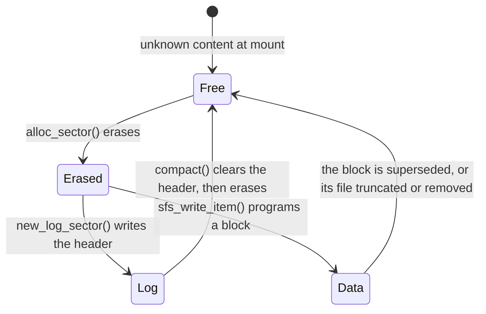

# SPI-NOR log store

The storage below the hash-tree file system on SPI-NOR: an append-only log of records on 4 KiB sectors (`core/tee/spinor_fs_store.c`).

Part of the [SPI-NOR secure storage low-level design](../README.md).

## SPI-NOR FS backend

SPI-NOR FS keeps the same hash-tree items as REE FS, but as records in an append-only log on a flash region, because NOR flash cannot overwrite in place: a program only clears bits and an erase resets a whole sector. An index in secure RAM maps each item key to its newest record and is rebuilt at every mount (`core/tee/spinor_fs_store.c`).

### Region and sectors

The region is the `optee-fs` partition from the secure DT, or `CFG_SPI_NOR_FS_OFFSET` / `CFG_SPI_NOR_FS_SIZE` of flash `CFG_SPI_NOR_FS_DEVICE`, registered as partition `optee-fs` at mount so that no other partition can overlap it. It is split into 4 KiB sectors (`SFS_UNIT`), at least 8 (`SFS_MIN_SECTORS`).

| Sector kind | Content | In RAM (`s->state[]`) |
| --- | --- | --- |
| Log | `struct sfs_log_hdr` (16 bytes: magic `0x4c464e53` "SNFL", version 1, log sequence number, CRC), then records appended in order | `SFS_SEC_LOG`, `s->log_seq[]` |
| Data | exactly one encrypted 4 KiB hash-tree block, written before the record that references it | `SFS_SEC_DATA` |
| Free | unknown content, erased before use | `SFS_SEC_FREE` |
| Erased | all 0xff, ready | `SFS_SEC_ERASED` |

### Record format (`struct sfs_rec_hdr`, 28 bytes)

| Field | Size | Meaning |
| --- | --- | --- |
| `magic` | 2 | `0x5243`; anything else ends the log of this sector |
| `type` | 1 | head, node, block (as `enum tee_fs_htree_type`), `SFS_REC_DEL`, `SFS_REC_TRUNC` |
| `vers` | 1 | hash-tree version, 0 or 1 |
| `file` | 4 | backend file: the dirf.db file number, `0x7fffffff` (`SFS_DIRF_FILE`) for dirf.db |
| `idx` | 4 | item index; for `TRUNC`, the first dropped block |
| `seq` | 4 | record sequence number, global and increasing |
| `len` | 2 | payload bytes after the header: 68 (head) or 66 (node), 0 otherwise |
| `sector` | 2 | data sector of a block |
| `data_crc` | 4 | CRC-32 of the data block |
| `crc` | 4 | CRC-32 of the header up to this field plus the payload |

Records are padded to 4 bytes. A key is (file, type, idx, vers); `struct sfs_item` holds the newest record of a key: its location, `seq`, the log sector holding the record, and `data_crc`. A `DEL` marker drops every item of its file with a lower `seq`; a `TRUNC` marker drops that file's blocks from `idx` up.

### How fs_htree items map to records

| Hash-tree call | Store call | Flash writes |
| --- | --- | --- |
| `rpc_read_init()` → `be_read_init()` | `sfs_read_item()` | none; a missing head or node reads as zeros, a missing block as a short read (like a sparse REE file) |
| `rpc_write_final()` → `be_write_final()` | `sfs_write_item()` | block: `alloc_sector()`, program the 4 KiB, then append the record; head or node: append the record with its payload |
| `be->truncate()` | `sfs_truncate_file()` | append `TRUNC` |
| `be->remove()` | `sfs_remove_file()` | append `DEL` |
| `be->create()` | drops any old items of that file number | append `DEL` if the file existed |

Data go through one secure buffer (`s->iobuf`); unlike REE FS, nothing is placed in shared memory.

### Mount (`sfs_mount()` → `scan()`)

1. Read every sector's header; valid log sectors are sorted by log sequence number.
2. `replay_sector()` each, oldest first: stop at an all-0xff header (clean end, appending can resume there) or at a bad magic, length or CRC (torn record: the sector is closed for appending).
3. `apply_rec()` updates the index: a newer `seq` replaces an item, markers drop items.
4. `drop_stale_blocks()`: if two live blocks claim one data sector, keep the higher `seq`.
5. Mark the sectors of live blocks as data; a block pointing at a log sector is dropped.
6. Append resumes in the newest log sector if it ended cleanly, else a new log sector is opened at the first write.

### Allocation and compaction

| Writer | Free sectors it must leave (`keep_for()`) | Why |
| --- | --- | --- |
| object data | `SFS_RESERVE` + `SFS_DIRF_RESERVE` = 4 | leaves room to update dirf.db and remove files on a full store |
| dirf.db (`SFS_DIRF_FILE`), `DEL` and `TRUNC` markers | `SFS_RESERVE` = 2 | operations that free space |
| compaction | 0 | it uses the reserve to make progress |

`alloc_sector()` takes the next free sector round-robin from `s->cursor` (spreading erase cycles), erasing it first if needed. When fewer free sectors than required remain, it calls `compact()`, up to once per sector, then fails with `TEE_ERROR_STORAGE_NO_SPACE`.

`compact()` moves the live records of the oldest log sector to the head of the log and erases it: it first programs the sector's header magic to 0, so an erase cut by power loss leaves a sector that reads as free, never one whose old records replay without the markers that cancelled them. A sector of only live records is still moved, so the next oldest one can be compacted. `compaction_frees()` stops when the live records of all log sectors would not fit in one log sector less, so a full store reports `NO_SPACE` instead of rotating forever. Compacting oldest first is what lets markers be dropped: every record a marker cancels is in the same sector or already gone.



## On-flash formats in detail

All integers are stored little-endian (CPU byte order on Arm). CRCs are
CRC-32/ISO-HDLC: reflected polynomial `0xedb88320`, initial value and final
XOR `0xffffffff` (`crc32_update()`, computed bit by bit, no table).

### Constants

| Name | Value | Meaning |
| --- | --- | --- |
| `SFS_UNIT` | 4096 | Sector size used by the store; the flash erase size must divide it |
| `SFS_LOG_MAGIC` | `0x4c464e53` ("SNFL") | First word of a log sector |
| `SFS_LOG_VERSION` | 1 | Format version of log sectors |
| `SFS_REC_MAGIC` | `0x5243` | First half-word of every record |
| `SFS_DIRF_FILE` | `0x7fffffff` | File number of dirf.db in records |
| `SFS_MIN_SECTORS` | 8 | Smallest region (32 KiB) |
| max sectors | 65,535 | Records hold a 16-bit sector number |
| `SFS_RESERVE` | 2 | Free sectors only compaction may use |
| `SFS_DIRF_RESERVE` | 2 | Further free sectors object data may not use |
| `SFS_MAX_PAYLOAD` | 68 | Largest payload: a hash-tree head |
| `SFS_LOG_ROOM` | 3,984 | Record space of a log sector less one largest record (4096 − 16 − 96), used by `compaction_frees()` |

### Log sector header (`struct sfs_log_hdr`, 16 bytes)

| Offset | Size | Field | Value |
| --- | --- | --- | --- |
| 0 | 4 | `magic` | `0x4c464e53` |
| 4 | 4 | `version` | 1 |
| 8 | 4 | `seq` | Log sequence number: orders log sectors; never `0xffffffff` |
| 12 | 4 | `crc` | CRC-32 of bytes 0 to 11 |

A sector is a log sector only if all four fields check. Records start at
offset 16.

### Record (`struct sfs_rec_hdr`, 28 bytes, then the payload)

| Offset | Size | Field |
| --- | --- | --- |
| 0 | 2 | `magic` |
| 2 | 1 | `type`: 0 head, 1 node, 2 block, 3 DEL, 4 TRUNC |
| 3 | 1 | `vers` |
| 4 | 4 | `file` |
| 8 | 4 | `idx`: 0 for a head, node ID − 1 for a node, block number for a block, first dropped block for TRUNC |
| 12 | 4 | `seq` |
| 16 | 2 | `len`: 68, 66 or 0 |
| 18 | 2 | `sector`: data sector of a block, else 0 |
| 20 | 4 | `data_crc`: CRC-32 of the 4,096 data bytes of a block, else 0 |
| 24 | 4 | `crc`: CRC-32 of bytes 0 to 23 and the payload |
| 28 | `len` | payload: `struct tee_fs_htree_image` or `struct tee_fs_htree_node_image` |

The next record starts at the next multiple of 4.

| Record | Size on flash |
| --- | --- |
| head | 28 + 68 = 96 bytes |
| node | 28 + 66 = 94, padded to 96 bytes |
| block, DEL, TRUNC | 28 bytes |

### Index entry (`struct sfs_item`, RAM only)

| Field | Meaning |
| --- | --- |
| `file`, `type`, `idx`, `vers` | Key |
| `len` | Payload length |
| `loc` | Byte offset of the payload in the region (head, node), or data sector (block) |
| `seq` | Sequence number of the record |
| `rec_sector` | Log sector holding the record, used to find the live records of a compaction victim |
| `data_crc` | Expected CRC of the data sector |

The index is an array, grown 32 entries at a time and searched linearly;
markers are not kept in it.

### Store state (`struct sfs`, RAM only)

| Field | Meaning |
| --- | --- |
| `nor`, `base`, `nsec` | Flash, region offset, number of sectors |
| `state[nsec]` | `FREE`, `ERASED`, `LOG` or `DATA` per sector |
| `log_seq[nsec]` | Log sequence number of each log sector |
| `head`, `head_off`, `head_valid` | Log sector and offset where the next record goes; not valid after a torn record or a failed program |
| `next_seq`, `next_log_seq` | Next record and log sequence numbers |
| `cursor` | Where the next sector search starts |
| `items`, `nitems`, `max_items` | Index |
| `iobuf` | One 4 KiB buffer for hash-tree items |
| `recbuf` | One record (28 + 68 bytes) |

## Algorithms in detail

### Replay of one log sector (`replay_sector()`)

```
off = 16
while off + 28 <= 4096:
    read header at off
    if magic != 0x5243:
        if the 28 bytes are all 0xff: end = off        (clean end)
        else:                         end = 4096       (torn: closed)
        return
    if len > 68 or the record would cross the sector: end = 4096; return
    read payload
    if crc fails or seq == 0xffffffff: end = 4096; return   (torn record)
    apply_rec(record)
    next_seq = max(next_seq, seq + 1)
    off += roundup(28 + len, 4)
end = 4096
```

`apply_rec()`:

| Record | Effect on the index |
| --- | --- |
| head, node | `set_item()` with `loc` = payload offset |
| block | `set_item()` with `loc` = `sector`; a sector number outside the region is `TEE_ERROR_CORRUPT_OBJECT` |
| DEL | drop every item of `file` with a lower `seq` |
| TRUNC | drop the blocks of `file` with `idx` ≥ the marker's `idx` and a lower `seq` |
| other type | `TEE_ERROR_CORRUPT_OBJECT` |

`set_item()` keeps the record with the higher `seq` for a key. When a newer
block replaces an older one on another sector, the older sector becomes free.

### Mount (`scan()`)

1. For each sector: read its 16-byte header; if valid, mark it `LOG`,
   record its `seq` and insert it into a list sorted by `seq`; else mark it
   `FREE`.
2. Replay the log sectors in increasing `seq`.
3. If the newest log sector ended cleanly, appending resumes there.
4. `drop_stale_blocks()`: two live blocks on the same sector come from a
   lost marker; keep the higher `seq` and log "shared sector".
5. For each live block: if its sector is already `LOG` or `DATA`, drop the
   block ("points at a used sector"); else mark the sector `DATA`.

Nothing is written during a mount.

### Sector allocation (`alloc_sector(keep)`)

1. While at most `keep` sectors are free and `keep` is not zero, run
   `compact()`; give up with `TEE_ERROR_STORAGE_NO_SPACE` after `nsec`
   rounds or when compaction cannot free anything.
2. Scan from `cursor`, wrapping around, for a `FREE` or `ERASED` sector.
3. Erase it if it is `FREE`; mark it `ERASED`.
4. Set `cursor` to the next sector.

| Writer | `keep` |
| --- | --- |
| Object data, object heads and nodes | 4 (`SFS_RESERVE + SFS_DIRF_RESERVE`) |
| dirf.db items | 2 |
| DEL and TRUNC markers | 2 |
| Compaction | 0 |

### Appending a record (`append()`)

1. Refuse with `TEE_ERROR_STORAGE_NO_SPACE` once `next_seq` would reach
   `0xffffffff`.
2. If there is no valid head sector or the record does not fit, open a new
   log sector: allocate one, program its header with `next_log_seq`.
3. Fill in `magic`, `seq`, `crc`; program header and payload in one
   `spi_nor_write()`.
4. On a program error, stop appending to that sector (`head_valid = false`):
   it may hold a partial record.

### Writing an item (`sfs_write_item()`)

| Item | Steps |
| --- | --- |
| block | `alloc_sector()`; program the 4,096 bytes; mark the sector `DATA`; compute `data_crc`; append the record. If the record cannot be appended, the sector goes back to `FREE`. |
| head, node | append the record with the item as payload |

Then `set_item()` makes the new record the live one for its key.

### Reading an item (`sfs_read_item()`)

| Case | Result |
| --- | --- |
| no item, head or node | the item size in zero bytes (fs_htree treats an all-zero head as never written) |
| no item, block | 0 bytes (a short read, which fs_htree reports as corrupt) |
| block | read the sector, compare its CRC with `data_crc`: `TEE_ERROR_CORRUPT_OBJECT` on mismatch |
| head, node | read `len` bytes at `loc`; integrity is checked by fs_htree |

### Compaction (`compact()`)

1. `compaction_frees()`: only go on if there are at least two log sectors
   and the live records fit in one log sector less
   (`live bytes ≤ (log sectors − 1) × 3,984`). Else
   `TEE_ERROR_STORAGE_NO_SPACE`.
2. Victim: the log sector with the lowest `seq` that is not the head.
3. For each item whose `rec_sector` is the victim: append a copy of its
   record (blocks keep their data sector; heads and nodes are re-read from
   flash) with `keep` 0, then point the item at the copy.
4. Program 4 bytes of zero over the victim's magic: from now on it cannot
   replay.
5. Erase the victim; mark it `ERASED`.

Markers are not copied: a DEL or TRUNC in the oldest log sector can only
cancel records in the same sector or in older, already erased ones.

### Backend callbacks

| `struct tee_fs_backend_ops` | Store function | Notes |
| --- | --- | --- |
| `open(dfh)` | `fs_store_ready()`, `file_exists()` | `TEE_ERROR_ITEM_NOT_FOUND` if no item has that file number |
| `create(dfh)` | `sfs_remove_file()` | Drops leftovers of a reused file number with a DEL |
| `close(fd)` | none | |
| `truncate(fd, n)` | `sfs_truncate_file()` | TRUNC only if a block ≥ n exists |
| `remove(dfh)` | `sfs_remove_file()` | DEL only if the file exists |
| `htree_storage.rpc_read_init/final` | `sfs_read_item()` into `iobuf` | |
| `htree_storage.rpc_write_init/final` | `sfs_write_item()` from `iobuf` | The key travels in `op->params[0]`: `a` = file, `b` = index, `c` = type << 8 \| version |

The file descriptor is the file number; dirf.db (`dfh == NULL`) is
`SFS_DIRF_FILE`.

### Error codes

| Code | Raised when |
| --- | --- |
| `TEE_ERROR_STORAGE_NOT_AVAILABLE` | No region, bad region, `optee-fs` declared but missing, region overlaps a partition |
| `TEE_ERROR_STORAGE_NO_SPACE` | No free sector after compaction; sequence numbers exhausted |
| `TEE_ERROR_CORRUPT_OBJECT` | Data CRC mismatch; a replayed block record names a sector outside the region |
| `TEE_ERROR_OUT_OF_MEMORY` | Index or buffers cannot grow |
| flash errors | Passed through from `spi_nor_*()` |

## Worked example: one write on SPI-NOR

A TEE_WriteObjectData() of 16 bytes inside an existing one-block object takes 6 log records, 2 data sectors and 1 RPMC increment; it takes effect at step 8, the dirf.db head. The example object is file 3 at dirent index 3, its head counter is 6 and its block's committed version is b; dirf.db's head counter and the RPMC anchor are both 41. Records are (type, file, idx, vers), where idx is the node ID − 1 for nodes and 0 for heads.

| # | Flash write | Record | State after a power cut here |
| --- | --- | --- | --- |
| 1 | erase a free sector S1 if needed, program the 4 KiB ciphertext of object block 0 (new IV, new tag in node 1) | none | old object: no record names S1, so it is free at mount |
| 2 | append the block record | BLOCK (2, 3, 0, !b), sector S1, data_crc | old object: the committed node 1 still names version b |
| 3 | append node 1, now with bit 0 flipped and a new hash | NODE (1, 3, 0, 1): version !(6 & 1) | old object: the head in slot 0 (counter 6) still names root version 0 |
| 4 | append the object head, counter 7 | HEAD (0, 3, 0, 1): slot 7 & 1 | old object: the dirent still holds the old root hash, which root version 0 matches, so the old head is used |
| 5 | erase a free sector S2 if needed, program dirf.db block 0 with dirent 3 (bytes 360–479) holding the new root hash | none | old state |
| 6 | append the dirf.db block record | BLOCK (2, 0x7fffffff, 0, new version) | old state: dirf.db's committed node still names the old block |
| 7 | append dirf.db node 1 | NODE (1, 0x7fffffff, 0, 0): version !(41 & 1) | old state |
| 8 | append the dirf.db head, counter 42 | HEAD (0, 0x7fffffff, 0, 0): slot 42 & 1 | **new state: this is the commit** |
| 9 | RPMC Increment Counter, 41 → 42, signed with the session HMAC key | none (an RPMC command, not a record) | new state, anchor 41: until the next commit, the image from before record 8 would still be accepted |

There are 9 steps but 6 records: each sector program comes before its record, and the RPMC increment is a flash command. The log grows by 28 + 96 + 96 + 28 + 96 + 96 = 440 bytes, and 8 KiB of data is programmed. Records 2 and 6 replace the records with the same key from two commits back, so their old data sectors become free at once; the sectors of the committed versions (b, and dirf.db's current block) stay in use.

On REE FS the same six items are written, as pwrite() calls at the get_offs_size() offsets of files /var/lib/tee/3 and /var/lib/tee/dirf.db through tee-supplicant. The anchor step is the RPMB write of dirfile.db.hash or nv_counter_incr_ree_fs_to(42).

