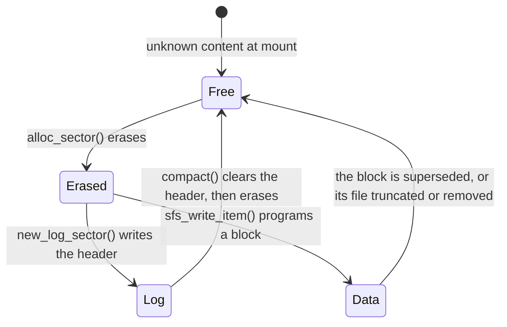

# SPI-NOR log store

The storage below the hash-tree file system on SPI-NOR: an append-only log of records on 4 KiB sectors (`core/tee/spinor_fs_store.c`).

Part of the [SPI-NOR secure storage low-level design](../README.md).

## SPI-NOR FS backend

SPI-NOR FS keeps the same hash-tree items as REE FS, but as records in an append-only log on a flash region, because NOR flash cannot overwrite in place: a program only clears bits and an erase resets a whole sector. An index in secure RAM maps each item key to its newest record and is rebuilt at every mount (`core/tee/spinor_fs_store.c`).

### Region and sectors

The region is the `optee-fs` partition from the secure DT, or `CFG_SPI_NOR_FS_OFFSET` / `CFG_SPI_NOR_FS_SIZE` of flash `CFG_SPI_NOR_FS_DEVICE`, registered as partition `optee-fs` at mount so that no other partition can overlap it. It is split into 4 KiB sectors (`SFS_UNIT`), at least 8 (`SFS_MIN_SECTORS`).

| Sector kind | Content | In RAM (`s->state[]`) |
| --- | --- | --- |
| Log | `struct sfs_log_hdr` (16 bytes: magic `0x4c464e53` "SNFL", version 1, log sequence number, CRC), then records appended in order | `SFS_SEC_LOG`, `s->log_seq[]` |
| Data | exactly one encrypted 4 KiB hash-tree block, written before the record that references it | `SFS_SEC_DATA` |
| Free | unknown content, erased before use | `SFS_SEC_FREE` |
| Erased | all 0xff, ready | `SFS_SEC_ERASED` |

### Record format (`struct sfs_rec_hdr`, 28 bytes)

| Field | Size | Meaning |
| --- | --- | --- |
| `magic` | 2 | `0x5243`; anything else ends the log of this sector |
| `type` | 1 | head, node, block (as `enum tee_fs_htree_type`), `SFS_REC_DEL`, `SFS_REC_TRUNC` |
| `vers` | 1 | hash-tree version, 0 or 1 |
| `file` | 4 | backend file: the dirf.db file number, `0x7fffffff` (`SFS_DIRF_FILE`) for dirf.db |
| `idx` | 4 | item index; for `TRUNC`, the first dropped block |
| `seq` | 4 | record sequence number, global and increasing |
| `len` | 2 | payload bytes after the header: 68 (head) or 66 (node), 0 otherwise |
| `sector` | 2 | data sector of a block |
| `data_crc` | 4 | CRC-32 of the data block |
| `crc` | 4 | CRC-32 of the header up to this field plus the payload |

Records are padded to 4 bytes. A key is (file, type, idx, vers); `struct sfs_item` holds the newest record of a key: its location, `seq`, the log sector holding the record, and `data_crc`. A `DEL` marker drops every item of its file with a lower `seq`; a `TRUNC` marker drops that file's blocks from `idx` up.

### How fs_htree items map to records

| Hash-tree call | Store call | Flash writes |
| --- | --- | --- |
| `rpc_read_init()` → `be_read_init()` | `sfs_read_item()` | none; a missing head or node reads as zeros, a missing block as a short read (like a sparse REE file) |
| `rpc_write_final()` → `be_write_final()` | `sfs_write_item()` | block: `alloc_sector()`, program the 4 KiB, then append the record; head or node: append the record with its payload |
| `be->truncate()` | `sfs_truncate_file()` | append `TRUNC` |
| `be->remove()` | `sfs_remove_file()` | append `DEL` |
| `be->create()` | drops any old items of that file number | append `DEL` if the file existed |

Data go through one secure buffer (`s->iobuf`); unlike REE FS, nothing is placed in shared memory.

### Mount (`sfs_mount()` → `scan()`)

1. Read every sector's header; valid log sectors are sorted by log sequence number.
2. `replay_sector()` each, oldest first: stop at an all-0xff header (clean end, appending can resume there) or at a bad magic, length or CRC (torn record: the sector is closed for appending).
3. `apply_rec()` updates the index: a newer `seq` replaces an item, markers drop items.
4. `drop_stale_blocks()`: if two live blocks claim one data sector, keep the higher `seq`.
5. Mark the sectors of live blocks as data; a block pointing at a log sector is dropped.
6. Append resumes in the newest log sector if it ended cleanly, else a new log sector is opened at the first write.

### Allocation and compaction

| Writer | Free sectors it must leave (`keep_for()`) | Why |
| --- | --- | --- |
| object data | `SFS_RESERVE` + `SFS_DIRF_RESERVE` = 4 | leaves room to update dirf.db and remove files on a full store |
| dirf.db (`SFS_DIRF_FILE`), `DEL` and `TRUNC` markers | `SFS_RESERVE` = 2 | operations that free space |
| compaction | 0 | it uses the reserve to make progress |

`alloc_sector()` takes the next free sector round-robin from `s->cursor` (spreading erase cycles), erasing it first if needed. When fewer free sectors than required remain, it calls `compact()`, up to once per sector, then fails with `TEE_ERROR_STORAGE_NO_SPACE`.

`compact()` moves the live records of the oldest log sector to the head of the log and erases it: it first programs the sector's header magic to 0, so an erase cut by power loss leaves a sector that reads as free, never one whose old records replay without the markers that cancelled them. A sector of only live records is still moved, so the next oldest one can be compacted. `compaction_frees()` stops when the live records of all log sectors would not fit in one log sector less, so a full store reports `NO_SPACE` instead of rotating forever. Compacting oldest first is what lets markers be dropped: every record a marker cancels is in the same sector or already gone.

## Worked example: one write on SPI-NOR

A TEE_WriteObjectData() of 16 bytes inside an existing one-block object takes 6 log records, 2 data sectors and 1 RPMC increment; it takes effect at step 8, the dirf.db head. The example object is file 3 at dirent index 3, its head counter is 6 and its block's committed version is b; dirf.db's head counter and the RPMC anchor are both 41. Records are (type, file, idx, vers), where idx is the node ID − 1 for nodes and 0 for heads.

| # | Flash write | Record | State after a power cut here |
| --- | --- | --- | --- |
| 1 | erase a free sector S1 if needed, program the 4 KiB ciphertext of object block 0 (new IV, new tag in node 1) | none | old object: no record names S1, so it is free at mount |
| 2 | append the block record | BLOCK (2, 3, 0, !b), sector S1, data_crc | old object: the committed node 1 still names version b |
| 3 | append node 1, now with bit 0 flipped and a new hash | NODE (1, 3, 0, 1): version !(6 & 1) | old object: the head in slot 0 (counter 6) still names root version 0 |
| 4 | append the object head, counter 7 | HEAD (0, 3, 0, 1): slot 7 & 1 | old object: the dirent still holds the old root hash, which root version 0 matches, so the old head is used |
| 5 | erase a free sector S2 if needed, program dirf.db block 0 with dirent 3 (bytes 360–479) holding the new root hash | none | old state |
| 6 | append the dirf.db block record | BLOCK (2, 0x7fffffff, 0, new version) | old state: dirf.db's committed node still names the old block |
| 7 | append dirf.db node 1 | NODE (1, 0x7fffffff, 0, 0): version !(41 & 1) | old state |
| 8 | append the dirf.db head, counter 42 | HEAD (0, 0x7fffffff, 0, 0): slot 42 & 1 | **new state: this is the commit** |
| 9 | RPMC Increment Counter, 41 → 42, signed with the session HMAC key | none (an RPMC command, not a record) | new state, anchor 41: until the next commit, the image from before record 8 would still be accepted |

There are 9 steps but 6 records: each sector program comes before its record, and the RPMC increment is a flash command. The log grows by 28 + 96 + 96 + 28 + 96 + 96 = 440 bytes, and 8 KiB of data is programmed. Records 2 and 6 replace the records with the same key from two commits back, so their old data sectors become free at once; the sectors of the committed versions (b, and dirf.db's current block) stay in use.

On REE FS the same six items are written, as pwrite() calls at the get_offs_size() offsets of files /var/lib/tee/3 and /var/lib/tee/dirf.db through tee-supplicant. The anchor step is the RPMB write of dirfile.db.hash or nv_counter_incr_ree_fs_to(42).

