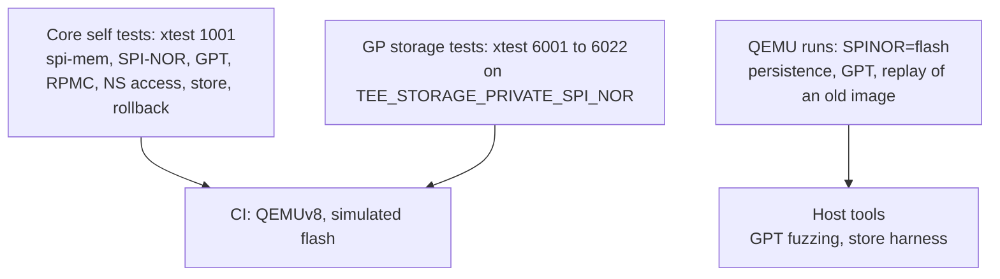

# Testing

How the SPI-NOR stack is tested: self tests inside OP-TEE core, the GP
storage tests in optee_test, CI, QEMU runs with a real flash model, and host
tools for the parts that need many cases. Each test lists the requirement it
verifies (see [01-requirements.md](../01-requirements.md)).

Part of the [SPI-NOR secure storage low-level design](../README.md).

## Test levels

## Core self tests (`xtest 1001`)

`xtest 1001` invokes the core self tests of the test PTA (`core/pta/tests/misc.c`).
The SPI-NOR ones run only with the simulated flash
(`CFG_SPI_NOR_EMBEDDED_TEST`, which needs `CFG_SPI_NOR_SIM` and
`CFG_TEE_CORE_EMBED_INTERNAL_TESTS`). They use the first 128 KiB of the
simulator and the 128 KiB after the store, so they never touch stored
objects.

### spi-mem (`core/pta/tests/spi_mem.c`)

| Case | Requirement |
| --- | --- |
| Command, address, dummy and data phases reach the controller in order; dummy and read bytes clock out the fill byte | REQ-FUN-07 |
| An operation without an opcode byte, a data phase without a buffer, quad data on a single-line device, or a transfer larger than the controller allows is rejected | REQ-FUN-07, REQ-SEC-09 |

### SPI-NOR core (`spi_nor_self_test()`, `core/drivers/spi_nor/spi_nor_selftest.c`)

| Test | Cases | Requirement |
| --- | --- | --- |
| `test_sfdp()` | Erase types sorted whatever the table order; a 9-dword JESD216 table gets 256-byte pages; no erase type at all is rejected; RPMC table absent, present (4 counters, OP1 `0x9b`, OP2 `0x96`), with the QEMU model's extra bits, and without hardening (flash used, RPMC off) | REQ-FUN-06 |
| `test_nor()` | 64 KiB then 4 KiB erase picked by alignment; a write across a page boundary split and verified; programming only clears bits (`0xf0` then `0x0f` gives `0x00`); erase restores `0xff`; misaligned and out-of-range requests rejected | REQ-FUN-06, REQ-REL-02 |
| `test_partitions()` | Overlap, duplicate label and bad ranges rejected; adjacent partitions accepted; iteration in order | REQ-FUN-05, REQ-SEC-07 |
| `test_dt_partitions()` (PR 2) | Labelled node, node name as label, disabled node ignored, one bad node drops all | REQ-FUN-08 |
| `test_gpt()` (PR 3), for 512- and 4096-byte blocks | Valid table; bad primary header or entries use the backup; both bad; backup found only in the last block; entry outside the usable range; overlapping entries keep nothing; CRC-32 check value `0xcbf43926` | REQ-FUN-09, REQ-SEC-09 |
| `test_rpmc()` (PR 4), counter 3 | No root key reported as such; root key written once; wrong root key refused; stale increment refused, counter unchanged; corrupted or replayed reply rejected; old session key useless after a new session | REQ-SEC-04, REQ-SEC-08 |
| `test_ns_access()` (later PR) | Offsets relative to the partition; read-only partition refuses program and erase; out of bounds, too long and misaligned requests rejected | REQ-FUN-10, REQ-SEC-07 |

### Store (`spinor_fs_store_self_test()`, `core/tee/spinor_fs_store.c`)

| Case | Requirement |
| --- | --- |
| An erased region mounts empty | REQ-FUN-05 |
| All item types written, one overwritten, remount finds the newest | REQ-REL-01 |
| Truncation and removal survive a remount | REQ-REL-01 |
| A torn record is ignored and appending resumes in a new sector | REQ-REL-01 |
| Rewriting one item many times wraps the log through compaction | REQ-REL-04 |
| Items written once fill whole log sectors; rewriting another item still compacts past them | REQ-REL-04 |
| Two blocks on one sector: the newer wins at mount | REQ-REL-01 |
| Filling with data ends in `TEE_ERROR_STORAGE_NO_SPACE`; dirf.db can still be updated and removal frees space | REQ-REL-03 |

### Rollback (`spinor_fs_rollback_self_test()`, `tee_ree_fs.c`)

Write an object, snapshot the simulated flash, write again, swap the
snapshot in and remount: refused with `TEE_ERROR_SECURITY` when an anchor is
active (RPMC or test NV counter), accepted without one; then the current
image is restored. See [rollback.md](rollback.md#tests). REQ-SEC-04,
REQ-SEC-05.

## GP storage tests (optee_test)

The optee_test `spinor` branch adds `TEE_STORAGE_PRIVATE_SPI_NOR` to the
storage table of `regression_6000.c`, so every 6000 test also runs on
SPI-NOR FS when OP-TEE reports it available, and treats it as size-limited in
the large-object test as for RPMB. It also detects which storage is behind
`TEE_STORAGE_PRIVATE`. With older OP-TEE the SPI-NOR runs are skipped.
REQ-FUN-01, REQ-FUN-02, REQ-FUN-03, REQ-TST-04.

`xtest _60` runs the 6000 series; `xtest 1001 _60` is the usual quick run.

## CI

`.github/workflows/ci.yml` builds QEMUv8 with
`CFG_DRIVERS_SPI_MEM=y CFG_DRIVERS_SPI_NOR=y CFG_SPI_NOR_SIM=y CFG_SPI_NOR_GPT=y
CFG_SPI_NOR_FS=y` (with `CFG_REE_FS=n`), and runs `make check` with a 1 MiB
simulator and a 512 KiB store. REQ-TST-03.

## QEMU runs

| Run | How | Checks |
| --- | --- | --- |
| Simulator | `make run SPINOR=sim`, then `xtest 1001 _60` | All self tests and storage tests; storage lost at reboot |
| Flash | `make run` (`SPINOR=flash`) | Probe of the QEMU flash, GPT, boot report, storage tests on the real flash model |
| Persistence | Two boots on the same `spinor.img` | Objects written in boot 1 read back in boot 2 |
| Replay | Four boots: fresh, remount, old image put back, current image restored | Old image refused with `TEE_ERROR_SECURITY`; current image works again |
| GPT from another tool | A table written by `sgdisk` | Parsed like the one from the build script |

`expect` is not installed on the development host, so `make check` is
replaced by a Python pty driver that boots QEMU and runs the xtest commands.

## Host tools

| Tool | What it does | Result |
| --- | --- | --- |
| GPT fuzzer | Compiles `gpt.c` on the host with small stubs, under AddressSanitizer and UBSan, and feeds about 633,000 mutated tables (headers, entries, CRCs, sizes) | No memory errors, no reads outside the disk, no partitions left by a rejected table |
| Store harness | Runs `spinor_fs_store.c` on a RAM flash on the host: 100,000 overwrites of one object on a minimal store, and a power cut during the erase of a compacted sector | No false "storage full"; no deleted file comes back after a cut during an erase |

## Per-commit builds

Every commit of every branch is built with warnings as errors, in three
configurations: simulator, simulator without GPT, and the QEMU flash platform.
REQ-TST-01. Gaps: Arm64 per-commit builds and power cuts at arbitrary points
on QEMU are not yet run.

## Results on the topic branches

| Branch | `xtest 1001 _60` |
| --- | --- |
| `topic/spinor`, `topic/dt`, `topic/gpt`, `topic/rpmc` | 2,396 subtests, 0 failed (simulator) |
| `topic/integration` | 0 failed on the QEMU flash, with persistence and GPT |
